# Cairn 2e Player's Guide (원문 추출)

> 원본: [Cairn_2e_Players_Guide.pdf](../../rule/Cairn_2e_Players_Guide.pdf) · Text CC BY-SA 4.0 · PyMuPDF 로 뽑은 그대로 (표는 칸이 줄로 풀려 있음)

---
## p.1

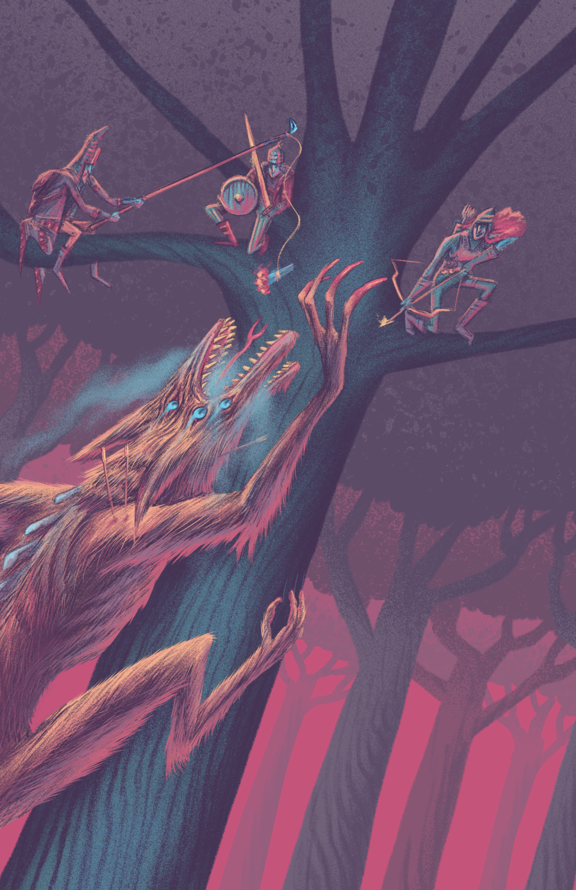

---
## p.2

2
Cairn 2e Player’s Guide
Cairn is an adventure game about exploring a dark and mysterious Wood filled 
with strange folk, hidden treasure, and unspeakable monstrosities. Character 
generation is quick and random, adventures are tense and reward careful 
exploration, and combat is frantic and deadly.
Credits & Acknowledgements
Writing
Yochai Gal
Editing & Development
Derek B.
Copy Editing
Yossi Krausz
Layout & Design
Adam Hensley
Cover Art
Bruno Prosaiko
Backgrounds Art
Keny Widjaja
Interior Illustrations
Amanda Lee Franck
Wilderness Exploration Sketch
Adam Hensley
The author would like to thank all 4,649 backers who helped make this project a 
reality, as well as his wife, Sarah. (She knows why.) And a special thanks to our 
Discord community for help with playtest feedback.
cairnrpg.com
Cairn 2nd Edition - Version 1.0.0. - April 2026 - Text is CC BY-SA 4.0

---
## p.3

3
Table of Contents
Overview . .  .  .  .  .  .  .  .  .  .  .  .  .  .  .  .  .  .  .  .  .  .  .  .  .  .  .  .  .  .  .  .  .  .  .  .  .  .  .  .  .  . 4
Principles for Players. .  .  .  .  .  .  .  .  .  .  .  .  .  .  .  .  .  .  .  .  .  .  .  .  .  .  .  .  .  .  . 5
Section 1: Character Creation. .  .  .  .  .  .  .  .  .  .  .  .  .  .  .  .  .  .  .  .  .  .  6
   Character Creation Summary. .  .  .  .  .  .  .  .  .  .  .  .  . . . . . . . . . . . . 8
   Character Traits. .  .  .  .  .  .  .  .  .  .  .  .  .  .  .  .  .  . . . . . . . . . . . . . . . . . . 10
   Bonds. .  .  .  .  .  .  .  .  .  .  .  .  .  .  .  .  .  .  .  .  .  . . . . . . . . . . . . . . . . . . . . . . . . 12
   Omens . .  .  .  .  .  .  .  .  .  .  .  .  .  .  .  .  .  .  .  .  .  . . . . . . . . . . . . . . . . . . . . . . . 14
   Marketplace. .  .  .  .  .  .  .  .  .  .  .  .  .  .  .  .  .  .  .  . . . . . . . . . . . . . . . . . . . . 16
Section 2: Backgrounds. .  .  .  .  .  .  .  .  .  .  .  .  .  .  .  .  .  .  .  .  .  .  .  .  .  .  .  . 18
   1. Aurifex. .  .  .  .  .  .  .  .  .  .  .  .  .  .  .  .  .  .  .  .  .  . . . . . . . . . . . . . . . . . . . . . 20
   2. Barber-Surgeon. .  .  .  .  .  .  .  .  .  .  .  .  .  .  .  .  . . . . . . . . . . . . . . . . . 22
   3. Beast Handler. .  .  .  .  .  .  .  .  .  .  .  .  .  .  .  .  .  . . . . . . . . . . . . . . . . . . 24
   4. Bonekeeper. .  .  .  .  .  .  .  .  .  .  .  .  .  .  .  .  .  .  . . . . . . . . . . . . . . . . . . . 26
   5. Cutpurse . .  .  .  .  .  .  .  .  .  .  .  .  .  .  .  .  .  .  .  . . . . . . . . . . . . . . . . . . . . 28
   6. Fieldwarden. .  .  .  .  .  .  .  .  .  .  .  .  .  .  .  .  .  .  . . . . . . . . . . . . . . . . . . . 30
   7. Fletchwind. .  .  .  .  .  .  .  .  .  .  .  .  .  .  .  .  .  .  .  . . . . . . . . . . . . . . . . . . . 32
   8. Foundling. .  .  .  .  .  .  .  .  .  .  .  .  .  .  .  .  .  .  .  . . . . . . . . . . . . . . . . . . . . 34
   9. Fungal Forager. .  .  .  .  .  .  .  .  .  .  .  .  .  .  .  .  .  . . . . . . . . . . . . . . . . . 36
   10. Greenwise. .  .  .  .  .  .  .  .  .  .  .  .  .  .  .  .  .  .  . . . . . . . . . . . . . . . . . . . 38
   11. Half Witch. .  .  .  .  .  .  .  .  .  .  .  .  .  .  .  .  .  .  .  . . . . . . . . . . . . . . . . . . . 40
   12. Hexenbane. .  .  .  .  .  .  .  .  .  .  .  .  .  .  .  .  .  .  . . . . . . . . . . . . . . . . . . . 42
   13. Jongleur . .  .  .  .  .  .  .  .  .  .  .  .  .  .  .  .  .  .  .  . . . . . . . . . . . . . . . . . . . . 44
   14. Kettlewright. .  .  .  .  .  .  .  .  .  .  .  .  .  .  .  .  .  .  . . . . . . . . . . . . . . . . . . 46
   15. Marchguard. .  .  .  .  .  .  .  .  .  .  .  .  .  .  .  .  .  .  . . . . . . . . . . . . . . . . . . 48
   16. Mountebank. .  .  .  .  .  .  .  .  .  .  .  .  .  .  .  .  .  .  . . . . . . . . . . . . . . . . . . 50
   17. Outrider . .  .  .  .  .  .  .  .  .  .  .  .  .  .  .  .  .  .  .  . . . . . . . . . . . . . . . . . . . . 52
   18. Prowler. .  .  .  .  .  .  .  .  .  .  .  .  .  .  .  .  .  .  .  .  . . . . . . . . . . . . . . . . . . . . 54
   19. Rill Runner. .  .  .  .  .  .  .  .  .  .  .  .  .  .  .  .  .  .  . . . . . . . . . . . . . . . . . . . 56
   20. Scrivener. .  .  .  .  .  .  .  .  .  .  .  .  .  .  .  .  .  .  .  . . . . . . . . . . . . . . . . . . . 58
Section 3: Core Rules. .  .  .  .  .  .  .  .  .  .  .  .  .  .  .  .  .  .  .  .  .  .  .  .  .  .  .  .  .  60
   Basic Rules. .  .  .  .  .  .  .  .  .  .  .  .  .  .  .  .  .  .  .  .  . . . . . . . . . . . . . . . . . . . . 62
   Combat. .  .  .  .  .  .  .  .  .  .  .  .  .  .  .  .  .  .  .  .  .  . . . . . . . . . . . . . . . . . . . . . . 64
   Scars. .  .  .  .  .  .  .  .  .  .  .  .  .  .  .  .  .  .  .  .  .  .  . . . . . . . . . . . . . . . . . . . . . . . 66
   Magic . .  .  .  .  .  .  .  .  .  .  .  .  .  .  .  .  .  .  .  .  .  .  . . . . . . . . . . . . . . . . . . . . . . 67
Section 4: Procedures. .  .  .  .  .  .  .  .  .  .  .  .  .  .  .  .  .  .  .  .  .  .  .  .  .  .  .  .  .  68
   Dungeon Exploration . .  .  .  .  .  .  .  .  .  .  .  .  .  .  .  . . . . . . . . . . . . . . . 70
   Wilderness Exploration. .  .  .  .  .  .  .  .  .  .  .  .  .  .  . . . . . . . . . . . . . . . 74
   Downtime . .  .  .  .  .  .  .  .  .  .  .  .  .  .  .  .  .  .  .  . . . . . . . . . . . . . . . . . . . . . 80
Section 5: The Setting of Vald. .  .  .  .  .  .  .  .  .  .  .  .  .  .  .  .  .  .  .  .  .  84
   Vald. .  .  .  .  .  .  .  .  .  .  .  .  .  .  .  .  .  .  .  .  .  .  .  . . . . . . . . . . . . . . . . . . . . . . . 86

---
## p.4

4
The Warden’s role is to act as a neutral arbiter and 
portray the rules, situations, non-player characters 
(NPCs), and narrative clearly.
A character’s role or skills are not limited by a single 
class. Instead, the equipment they carry and their 
experiences define their specialty.
Characters may be powerful, but they are also 
vulnerable to harm in its many forms. Death is always 
around the corner, but it is never random or without 
warning.
Dice do not always reflect an obstacle’s difficulty or 
its outcome. Instead, success and failure are based on 
in-world elements and arbitrated by the Warden in 
dialogue with the players.
Characters are changed through in-world 
advancement, gaining new skills and abilities 
by surviving dangerous events and overcoming 
obstacles.
Players should always understand the reasons 
behind the choices they’ve made, and information 
about potential risks should be provided freely and 
frequently.
The Warden and the players each have guidelines 
that help foster a specific play experience defined 
by critical thinking, exploration, and an emergent 
narrative.
Players trust one another to engage with the shared 
setting, character goals, and party challenges. 
Therefore the party is typically working together 
towards a common goal, as a team.
Neutrality
Classless
Death
Fiction First
Growth
Player Choice
Principles
Shared Objectives
Overview
Cairn was written with the following design philosophies in mind:

---
## p.5

5
Principles for Players
Agency
-  Attributes and related saves do not define your character. They are tools.
-  Don’t ask only what your character would do; ask what you would do, too.
-  Be creative with your intuition, items, and connections.
Teamwork
-  Seek consensus from the other players before barreling forward.
-  Stay on the same page about goals and limits, respecting each other and 
accomplishing more as a group than alone.
Exploration
-  Asking questions and listening to detail is more useful than any stats, items, or 
skills you have.
-  Take the Warden’s description without suspicion, but don’t shy away from 
seeking more information.
-  There is no single correct way forward.
Talking
-  Treat NPCs as if they were real people, and rely on your curiosity to safely 
gain information and solve problems.
-  You’ll find that most people are interesting and will want to talk things 
through before getting violent.
Caution
-  Fighting is a choice and rarely a wise one; consider whether violence is the 
best way to achieve your goals.
-  Try to stack the odds in your favor, and retreat when things seem unfavorable.
Planning
-  Think of ways to avoid your obstacles through reconnaissance, subtlety, and 
fact-finding.
-  Do some research, and ask around about your objectives.
Ambition
-  Set goals, and use your meager means to take steps forward.
-  Expect nothing. Earn your reputation.
-  Keep things moving forward, and play to see what happens.

---
## p.6

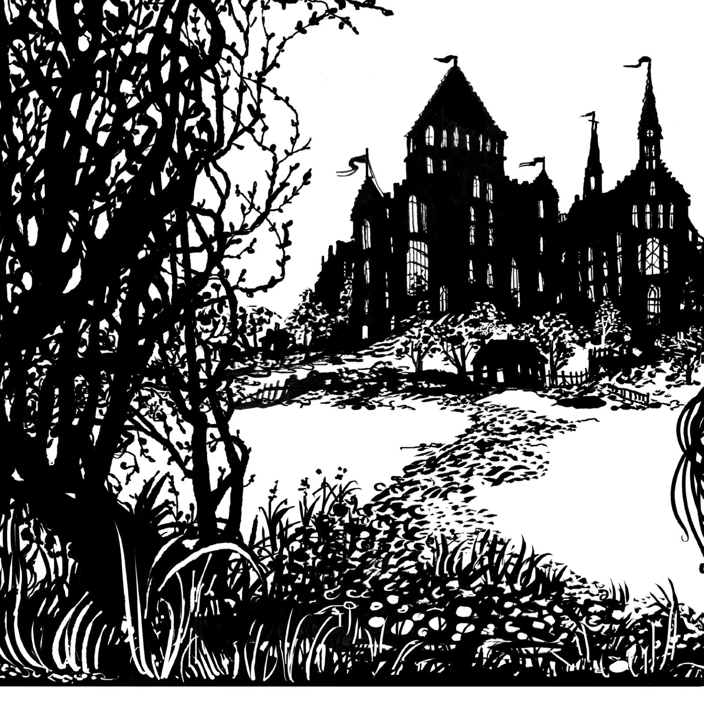

6
Section 1
Character Creation

---
## p.7

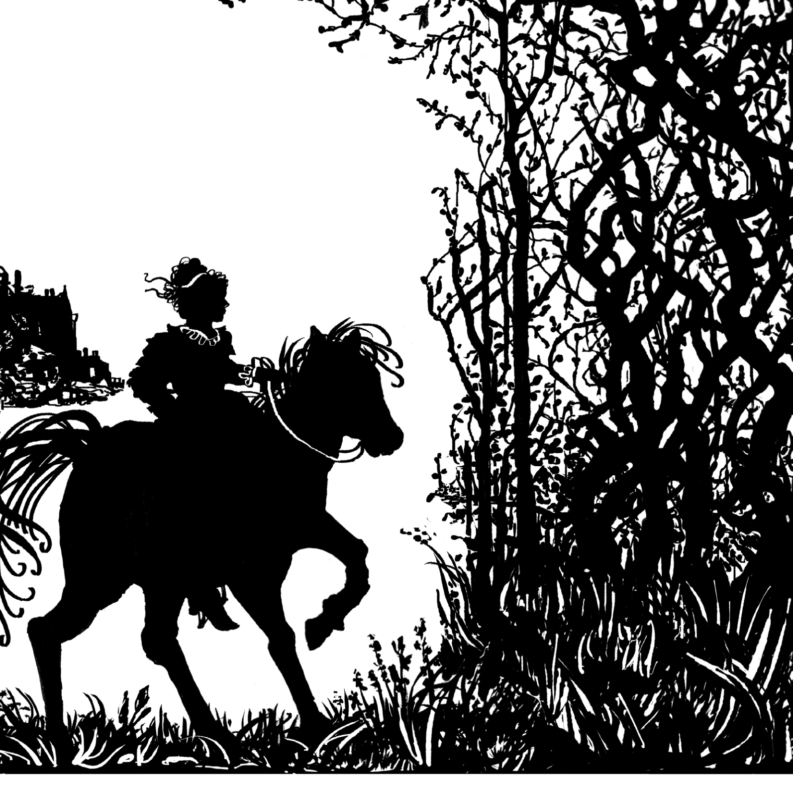

7

---
## p.8

8
Creating a Character
Roll or Choose a Background
-  First, roll or choose from the Backgrounds table below and note the page 
number. You will refer to that page for the next few steps.
-  Choose a name from the available list, then record each of your character’s 
starting items. See Inventory and Inventory Slots for how to record items.
-  Roll on each of the included tables in the background. Record your character’s 
items, skills, or abilities from each result. Some backgrounds may ask you to 
refer to the tables in the Marketplace (pg. 16) as well.
Attributes, Hit Protection, and Traits
-  Roll for your character’s Attributes and Hit Protection.
-  Roll for the rest of your character’s Traits (pg. 10), and then on the Bonds table 
(pg. 12).
-  Finally, roll for your character’s Age (2d20+10). If you are the youngest 
character, roll on the Omens table (pg. 14). The result should be read aloud to 
the other players. The Warden should incorporate Omens into the setting as 
they see fit.
Backgrounds
Backgrounds (d20)
1
Aurifex (pg. 20)
11
Half Witch (pg. 40)
2
Barber-Surgeon (pg. 22)
12
Hexenbane (pg. 42)
3
Beast Handler (pg. 24)
13
Jongleur (pg. 44)
4
Bonekeeper (pg. 26)
14
Kettlewright (pg. 46)
5
Cutpurse (pg. 28)
15
Marchguard (pg. 48)
6
Fieldwarden (pg. 30)
16
Mountebank (pg. 50)
7
Fletchwind (pg. 32)
17
Outrider (pg. 52)
8
Foundling (pg. 34)
18
Prowler (pg. 54)
9
Fungal Forager (pg. 36)
19
Rill Runner (pg. 56)
10
Greenwise (pg. 38)
20
Scrivener (pg. 58)

---
## p.9

9
Attributes
-  Player Characters (PCs) have just three attributes: Strength (STR), Dexterity 
(DEX), and Willpower (WIL).
-  Roll 3d6 for each of your character’s attributes, in order. You may then swap 
any two of the results. 
-  Attributes are not universal descriptors. A character with a low STR is not 
necessarily hopelessly weak; they can still attempt to lift a heavy door or 
survive a deadly fight! Their risk is simply higher.
Hit Protection
-  Roll 1d6 to determine your PC’s starting Hit Protection (HP), which reflects 
their ability to avoid damage in combat. It does not indicate a character’s 
health or fortitude, nor do they lose it for very long. (See Healing in the Core 
Rules (pg. 62).)
-  If an attack takes a PC’s HP exactly to 0, the player must reference the Scars 
table (pg. 66).
Inventory
-  Characters have a total of ten inventory slots but can only carry four items 
comfortably without the help of bags, backpacks, horses, carts, etc.
-  Each PC starts with a Backpack that can hold up to six slots of items or 
Fatigue (pg. 62). Carts (which must be pulled with both hands), Horses, or 
Mules can make a huge difference in how much a PC can bring with them on 
an adventure. Hirelings can also be paid to carry equipment.
-  Inventory is abstract, dependent only on the fiction as adjudicated by the 
Warden. Anyone carrying a full inventory (i.e. filling all 10 slots) is reduced to 0 
HP. A character cannot fill more than ten slots.
Inventory Slots
-  Most items take up one slot, unless otherwise indicated.
-  Petty items do not take up any slots. Bulky items take up two slots.
-  A bag of coins worth less than 100gp is petty and does not occupy a slot.

---
## p.10

10
Physique (d10)
1
Athletic
6
Scrawny
2
Brawny
7
Short
3
Flabby
8
Statuesque
4
Lanky
9
Stout
5
Rugged
10
Towering
Skin (d10)
1
Birthmarked
6
Soft
2
Marked
7
Tanned
3
Oily
8
Tattooed
4
Rosy
9
Weathered
5
Scarred
10
Webbed
Hair (d10)
1
Bald
6
Long
2
Braided
7
Luxurious
3
Curly
8
Oily
4
Filthy
9
Wavy
5
Frizzy
10
Wispy
Face (d10)
1
Bony
6
Perfect
2
Broken
7
Rakish
3
Chiseled
8
Sharp
4
Elongated
9
Square
5
Pale
10
Sunken
Character Traits

---
## p.11

11
Clothing (d10)
1
Antique
6
Frayed
2
Bloody
7
Frumpy
3
Elegant
8
Livery
4
Filthy
9
Rancid
5
Foreign
10
Soiled
Virtue (d10)
1
Ambitious
6
Honorable
2
Cautious
7
Humble
3
Courageous
8
Merciful
4
Disciplined
9
Serene
5
Gregarious
10
Tolerant
Vice (d10)
1
Aggressive
6
Lazy
2
Bitter
7
Nervous
3
Craven
8
Rude
4
Deceitful
9
Vain
5
Greedy
10
Vengeful
Speech (d10)
1
Blunt
6
Gravelly
2
Booming
7
Precise
3
Cryptic
8
Squeaky
4
Droning
9
Stuttering
5
Formal
10
Whispery
Character Traits

---
## p.12

12
Bonds
d20
Bonds
1
You inherited a single Gem (500gp, cold and brittle) from a long-dead 
relative. It arrived with a warning: squander your newfound riches, and 
a debt long thought forgotten would be called in.
2
A distant cousin left you a small inheritance. Take 20gp and a Strange 
Compass (petty) that always points towards something deep in the 
Wood.
3
You carry a hand-drawn Portrait (petty) of a past love who disappeared 
into the Wood long ago. Somehow you know that they are still alive.
4
You found a Tiny Crystal Prism (petty) buried in the dirt. When held 
up to the light, it shows visions of an unknown location deep within the 
Wood. Sometimes you feel a presence looking back at you.
5
You once freed a Naiad from a choked stream. In return, it gave you 
some Silver Moss (petty). Swallow it near water, and the creature will 
come, once, to repay its debt.
6
You inherited an old Journal, bound in bark. Each evening, its pages 
are filled with the events of the day, crassly written from the journal’s 
perspective. The writing is crude but accurate.
7
You protect a long-dormant family secret. Take one half of an Ancient 
Key (petty). They say that if joined with its twin, it opens a Gate through 
any door.
8
You received a Letter (petty) detailing incontrovertible proof that your 
true parentage is that of Fae nobility. The note also indicates a date and 
location where you are to meet the letter’s author, deep in the Wood.
9
You owe a great debt to a member of the nobility and carry their Signet 
Ring (petty), which serves as proof of their protection as well as your 
obligation.
10
You consumed a Mischievous Spirit that wreaks havoc on your insides, 
demanding to be taken home, deep in the Wood. It occupies one slot 
but absorbs one Fatigue each day. It wants you alive (for now).

---
## p.13

13
d20
Bonds
11
A roaming storyteller once spun you tales of great treasure hidden 
deep in the Wood. You thought it naught but fancy, till they gave you a 
Rolled-up Map (petty) marked with an X.
12
During your travels, you met a dying hunter who asked you to deliver a 
message to their loved ones. Take a Letter (petty), sealed with tree sap. 
It is addressed only to the Lord of Winter.
13
You found a wounded beast in the forest but chose to ignore it. You 
see it everywhere now, but only when you’re alone. It looks sad but not 
angry. You cannot become panicked when acting alone.
14
You promised a childhood friend that you’d bring them back a rare gift, 
something unique in all the world. Take a Bracelet (petty) woven from 
twine and wildflowers.
15
You crossed a creature of the Wood, and it cursed you with a Stone 
Heart. With each passing month, the stone grows heavier by one slot. 
Until your debt is lifted, you cannot truly die.
16
You carved a Whistle (petty) from an Oak Lord’s branch. Your act did 
not go unnoticed. You cannot seem to rid yourself of the whistle either.
17
The Dawn Brigade did your family a service, giving you a dried Blood-
Red Flower (petty) as proof. When the flower turns white, it means the 
favor is owed.
18
An entertainer once visited your home, filling it with story and song. 
He left one day without a word, leaving behind only a Miniature Lute. 
Something rattles inside.
19
A white crow appeared to you in a dream, holding a twig in its mouth. 
You awoke the next morning with the Twig (petty) in your hand. You 
believe it brings you luck. It smells faintly of sulfur.
20
One of your ancestors wronged a Moss Witch, who cursed their 
bloodline. Your visage causes mirrors to shatter. You’ve noticed that the 
shards can sometimes reveal illusions.

---
## p.14

14
Omens
d20
Omens
1
The once rich waters of a life-giving river have turned black and putrid, 
tainting the land and sickening those who drink from it. A village elder 
points to some recent desecration as the cause, but most do not heed 
their words.
2
It feels like winter has arrived too quickly this year, frost and snows 
making their appearance much earlier than expected. There is talk of a 
pattern to the frost found in windows, ponds, and cracks in the ground. 
It almost looks like a map.
3
A thick, unnatural fog has begun encroaching upon an ancient and holy 
grove. It is said to be the work of a great forest spirit, angered by nearby 
deforestation.
4
The night sky grows dimmer each evening, as if stars are disappearing 
one by one. Rumors of hellish creatures capturing farmers and pulling 
them into the Roots are spreading like wildfire. Village elders believe the 
two are connected.
5
The songbirds of the Wood have fallen eerily silent as of late. Hunters 
claim that a spectral figure has been spotted wandering the forest, 
gazing longingly at anyone it encounters.
6
Strange, tear-shaped stones have been found throughout the region, 
sparking a “gold rush” of sorts for jewelers and thieves alike. The locals 
believe they are the tears of the earth itself, weeping for a great tragedy 
yet to come.
7
Swarming pests gnaw away at the edges of dreams, and farmers speak 
of a loud buzzing sound emanating from deep within the Wood. They 
also say that the sound is getting closer.
8
There is a village known far and wide for its impressive “mother tree,” 
said to shelter the town’s secrets in its boughs. Recently it has begun 
bleeding red sap, worrying the elders.
9
The moon turns a deep crimson, bathing the night in an eerie, 
blood-red light. Some say it heralds a time of chaos and strife, as the 
boundaries between the Wood and the mortal realm grow thin.
10
Strange cracks have appeared in the night sky, revealing a swirling 
vortex of light and color. Some say that the divide between realms is at 
its weakest in centuries and fear what may emerge from the other side.

---
## p.15

15
d20
Omens
11
A night-blooming flower once thought extinct is sprouting up 
throughout the Wood. Its scent is intoxicating but also causes vivid 
nightmares.
12
Local livestock have grown increasingly agitated and unmanageable 
as of late. An old shepherd says it is due to an unsettling howl that 
emanates from the Wood each full moon.
13
Swarms of insects are fleeing from the Wood in droves, destroying any 
wooden structures they come across. The sound of their wings hum a 
familiar tune as they pass overhead, like a forgotten nursery rhyme.
14
Hunters talk of a curse that befalls any who kill any beast with a streak 
of white fur: soon after, they are found dead in their homes. Each day, 
there are fewer and fewer creatures to hunt.
15
Folks say that a faint laughter can be heard echoing out of wells all over 
the city, and that the echoes change to sobs at night.
16
The constellations have slowly started shifting in the night sky, forming 
unfamiliar patterns that have stargazers and sages perplexed. Even the 
animals seem disturbed.
17
An ancient tree at the heart of a sleepy village has suddenly withered 
and died, despite showing no signs of disease. After its trunk was cut, a 
bloody hand was found in its core.
18
Statues have been weeping blood for months on end, and the wombs 
of the village have lain barren since. A single child has been the only 
exception, hidden away by elders overcome with fear and dread.
19
Local fauna is behaving oddly, displaying heightened aggression or 
fleeing the area entirely. Hunters talk of a shadowy figure that roams 
the Wood, calling to the animals.
20
Border towns have become riotous in recent weeks after multiple claims 
of a red-robed figure appearing in their children’s dreams, uttering the 
same warning: A fire is coming, and it will consume everything.

---
## p.16

16
Marketplace
Armor
gp
Shield (+1 Armor)
10
Helmet (+1 Armor)
10
Gambeson (+1 Armor)
15
Brigandine (1 Armor, bulky)
20
Chainmail (2 Armor, bulky)
40
Plate (3 Armor, bulky)
60
Weapons
gp
Dagger, Cudgel, Sickle, Staff, etc. (d6 damage)
5
Spear, Sword, Mace, Axe, Flail, etc. (d8 damage)
10
Halberd, War Hammer, Long Sword, etc. (d10 damage, bulky)
20
Sling (d6 damage)
5
Bow (d6 damage, bulky)
20
Crossbow (d8 damage, bulky)
30
Transport
gp
Cart (+4 slots, bulky)
30
Wagon (+8 slots, slow)
200
Horse (+4 slots)
75
Mule (+6 slots, slow)
30
Carriage Seat
5
Ship’s Passage
10
Upkeep & Recovery
gp
Room & Board (per night)
10
Private Room & Board (fits 4)
35
Stable & Feed (per night)
5
Medical Healing
50
Rations (3 uses)
10
Animal Feed (3 uses, bulky)
5
Hirelings (daily rate in gp)
Alchemist
30
Navigator
10
Animal Handler
5
Sailor
5
Blacksmith
15
Scholar
20
Bodyguard
10
Tracker
5
Local Guide
5
Trapper
5
Lockpick
10
Veteran Bodyguard
20

---
## p.17

17
Gear
gp
Air Bladder
5
Antitoxin
20
Bandages (3 uses)
30
Bathing Goods (Soap, Perfume, etc.)
5
Book
50
Caltrops
10
Card Deck
5
Chain (10ft)
10
Chalk (petty)
1
Chest
25
Chisel
5
Common Agents (Glue, Grease, etc.)
10
Common Tools (Hammer, Shovel, etc.)
10
Compass
75
Complex Instruments (Bagpipes, Fiddle, etc.)
50
Containers (Sack, Waterskin, etc.)
10
Cooking Gear (Pots, Utensils, etc.)
10
Costume Gear (Face Paint, Disguise)
15
Dowsing Rod
15
Expeditionary Gear (Climbing Spikes, Pulley, etc.)
10
Fire Oil
10
Fishing Rod
10
Games (Cards, Dice, etc.)
10
Gloves (petty)
20
Grappling Hook
25
Lantern
10
Mirror
5
Net
10
Oil Can (6 uses)
10
Outdoor Comfort (Blanket, Hammock, etc.)
10
Parchment (3 uses)
10
Pole (10ft)
5
Repellent (Wolfsbane, Mugwort, etc.)
10
Rope (25ft)
5
Sedative
30
Sewing Kit
20
Simple Instruments (Pipes, Lute, etc.)
10
Smoking Pipe (petty)
15
Specialized Tools (Ink, etc.)
20
Spiked Boots
15
Spyglass
40
Tent (fits 2, bulky)
20
Thieving Tools (Lockpick, Metal File, etc.)
25
Torch (3 uses)
5
Trap (d6 STR damage)
35
Whistle (petty)
15
Wilderness Clothes (Poncho, Cloak, etc.) (petty)
15

---
## p.18

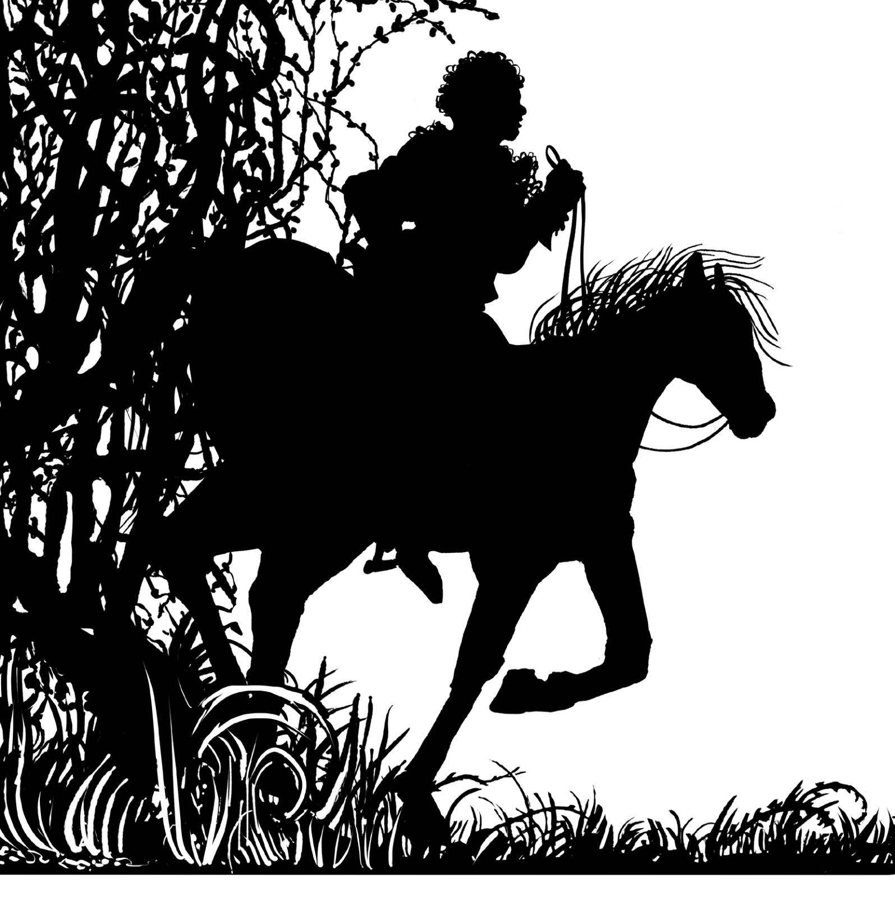

18
Section 2
Backgrounds

---
## p.19

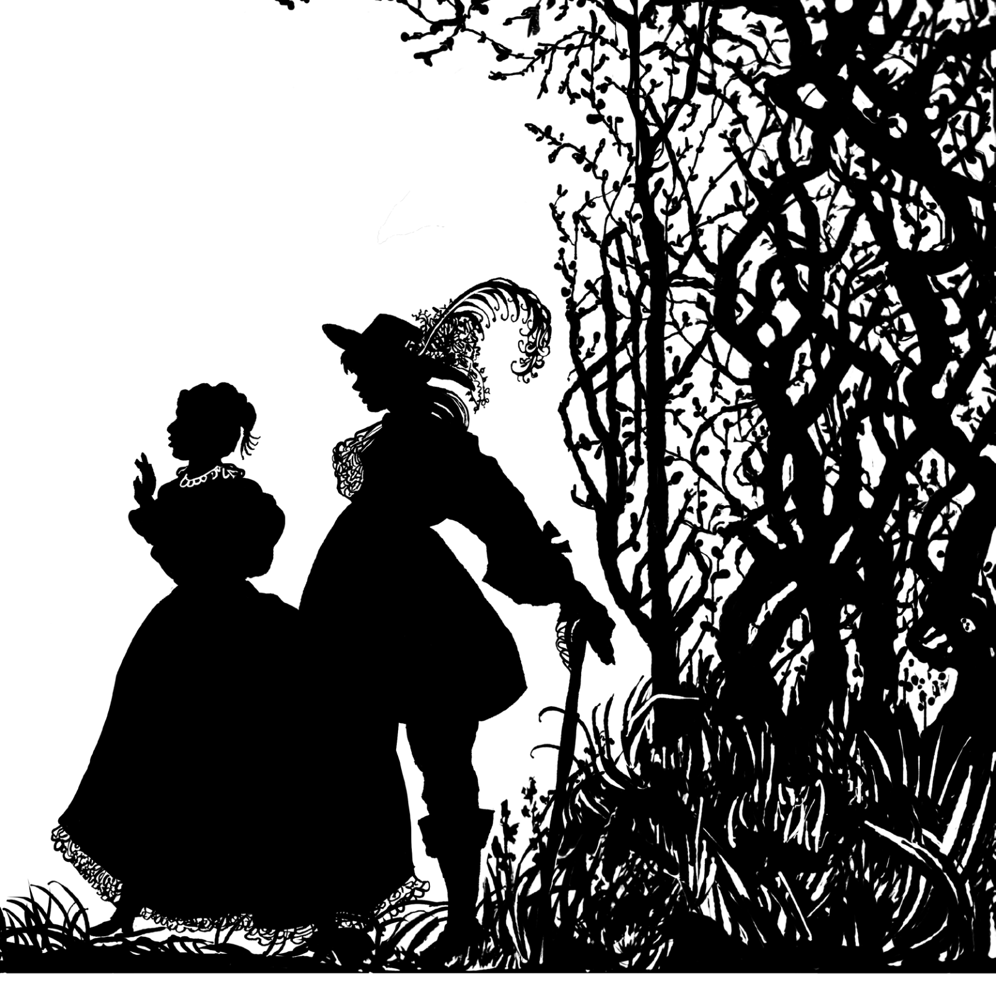

19

---
## p.20

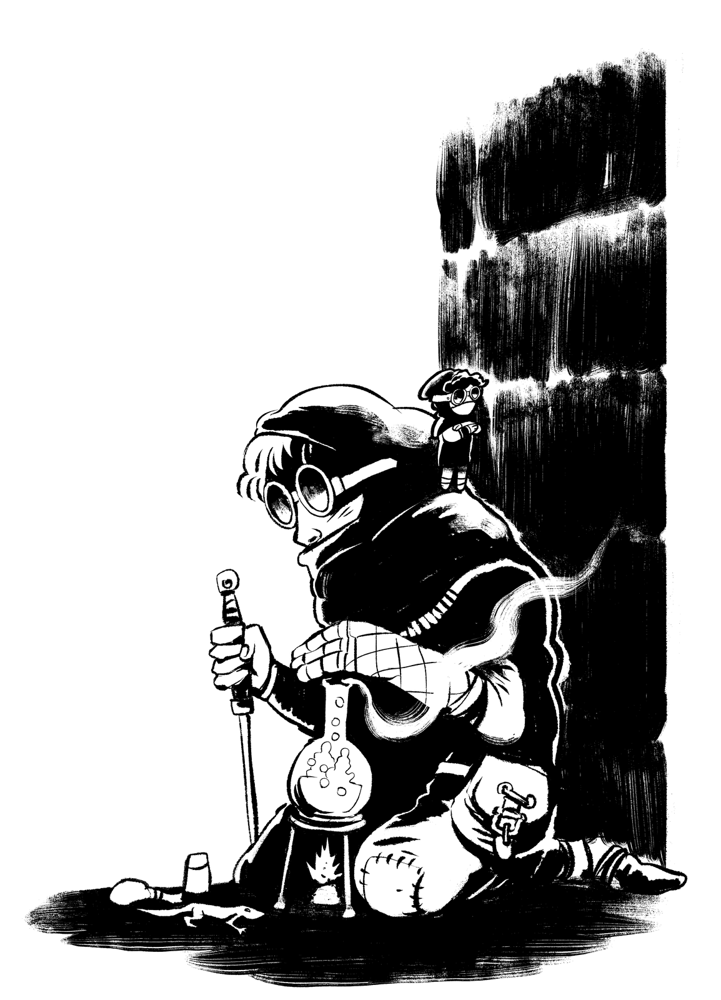

20
Names: Hestia, Basil, Rune, Prism, Ember, Quintess, Aludel, Mordant, Salaman, 
Jazia
You are an artisan of the arcane, a smith of subtle forces. In the crucible of your 
workshop, the laws that govern this world are warped to suit your needs.
Starting Gear
-  3d6 Gold Pieces
-  Rations (3 uses)
-  Lantern
-  Oil Can (6 uses)
-  Needle-Knife (d6)
-  Protective Gloves (petty)
Aurifex
BACKGROUND 1

---
## p.21

21
d6
What experiment went horribly wrong?
1
There was an explosion, and you lost your sense of smell. Well, almost: 
you can sniff out gold as a pig does truffles. Take a Tin of Snuff (6 uses) to 
dampen the impact. Use it every day or become deprived.
2
You dematerialized a beloved pet. Now it follows you around, invisible 
but always present. Although it cannot interact with the physical realm, 
you are able to share its sense. (Add a Fatigue each time. ) It follows basic 
commands.
3
You were exposed to a long-acting truth serum whose effects have yet to 
wear off. The disorder has its advantages: you cannot repeat lies you’ve 
heard, either.
4
You were adept at creating fake gold, which is almost as good. Eventually, 
your ruse was discovered, and you had to make a hasty retreat. Take a 
heavy Metal Ingot and Gold Powder (3 uses).
5
Your alchemical recipe worked, but a rival stole the blueprint before your 
claims could be proven. Take a prototype Blunderbuss (d12, blast, bulky) 
that takes one round to reload, and a taste for revenge.
6
Ridiculed for discovering how to turn gold into lead, you were a laughing 
stock. Take a bottle of Universal Solvent (2 uses) that dissolves anything it 
touches into its constituent parts.
d6
What alchemical marvel is the product of your latest ingenuity?
1
Pyrophoric 
Gel
A sticky green fluid that catches fire when exposed to air, 
then burns for 8 hours. Cannot be extinguished (1 use).
2
Blast Sphere
A head-sized iron ball filled with explosive powder that 
explodes on impact (d12, blast, bulky, 1 use).
3
Aqua Vita
Purifies any liquid, converting it to pure water. Drinking it 
cures 1d6 STR (1 use).
4
Mimic Stone
Records a short phrase that can later be played back.
5
Spark Dust
Ignites easily and quickly. Useful for starting a fire or as an 
incendiary device (3 uses).
6
Homunculus
A miniature clay replica of yourself that follows your every 
command. It hates being enthralled to you and complains 
bitterly whenever possible. Any damage done to the 
homunculus is also done to you. 3 HP, 4 STR, 13 DEX, 5 
WIL

---
## p.22

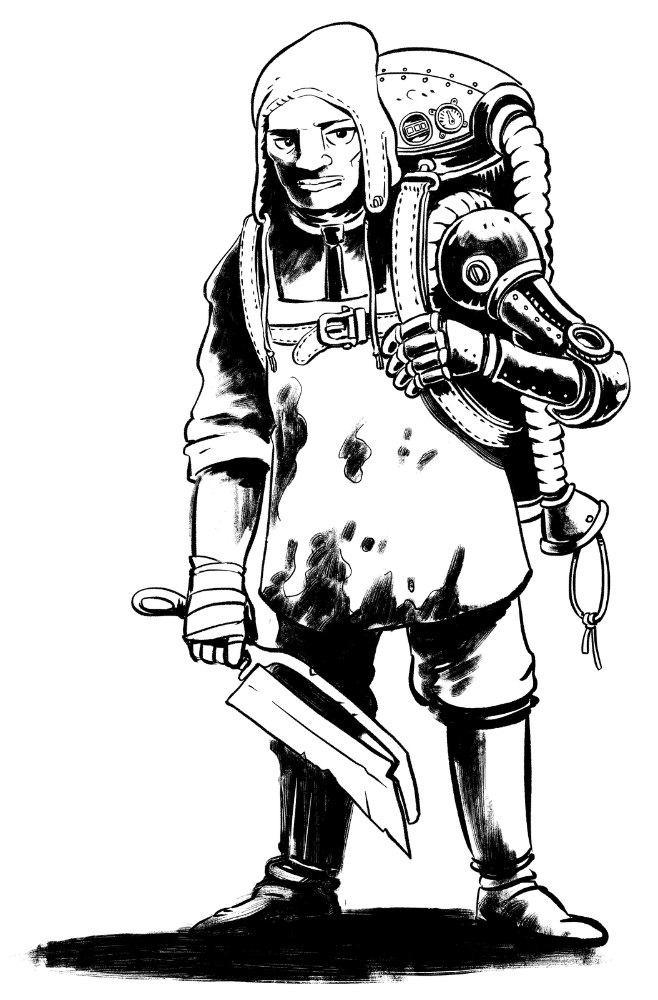

22
Names: Wilmot, Patch, Lancet, Sawbones, Theo, Cutwell, Humor, Landsford, 
Goodeye, Johanna
You walk the line between healer and harrower, knowing the frailty of the flesh 
but also the secrets that lie within. With the right tools, life and death are merely 
words.
Starting Gear
-  3d6 Gold Pieces
-  Rations (3 uses)
-  Torch (3 uses)
-  Amputation Knife (d6)
-  Bandages (3 uses)
-  Leech (restores 1 STR, 3 uses)
-  Stained Medical Finery (petty)
Barber-Surgeon
BACKGROUND 2

---
## p.23

23
d6
How have you “improved” yourself?
1
You have a replacement eye that can magnify objects, act as a telescope, 
and provide minimal night vision. You cannot wear anything metal on 
your head, and strong magnets make you deprived.
2
One foot is mostly metal (kick, d6), and you treat some Tough Terrain 
as Easy. Carry an Oil Can (6 uses). Without a daily application, you are 
deprived and noisy.
3
One of your fingers has been swapped, the bone replaced by gold and 
iron. Take a Hook and a Screwdriver that can attach to the fingertip.
4
Both ears have been surgically enhanced, tripling your hearing. You can
focus on a specific sound, such as a conversation, at a great distance. You 
wear an ear flap to protect against sudden loud noises (WIL save to avoid 
temporary paralysis).
5
Your chest is lined with alchemical sigils, toughening the skin (1 Armor). 
Wearing other metallic armor nullifies the effect.
6
One arm is fully metal and comes off at the shoulder. It can be used as a 
weapon (d8, bulky when not attached) and can move independently if you 
are within sight of it.
d6
What rare tool is essential to your work?
1
Regrowth 
Salve
Regrows a body part over the course of a day (1 use).
2
Graftgrub
A small worm that can fuse inanimate objects with parts 
of the body (1 use).
3
Woundwax
Heals wounds from fire or chemicals (restoring full STR) 
but nothing else (2 uses).
4
Quicksilver
A stimulant. Go first in combat, and automatically pass any 
WIL saves for one hour. Addictive: Save STR or become 
deprived after 24 hours without it (4 uses).
5
Pneuma 
Pump
Portable iron lungs (bulky). Enables life-saving surgery or 
underwater breathing.
6
Lodestone
Draws out dangerous elements from the body, and acts as 
a powerful magnetic force.

---
## p.24

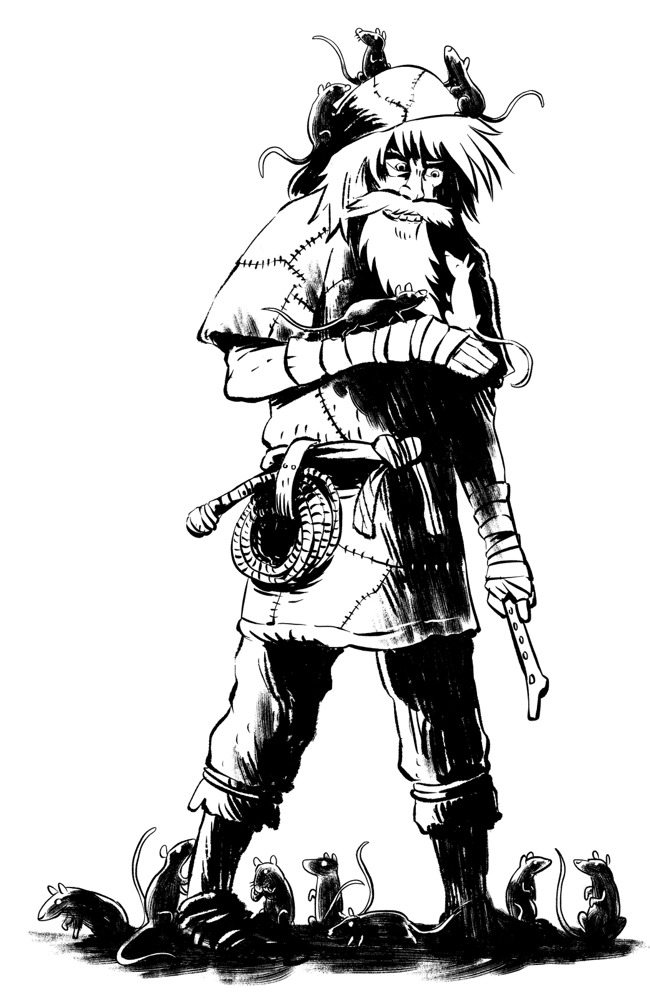

24
Names: Amara, Wulf, Mireille, Soren, Freki, Aster, Gerrik, Boreas, Veda, Matheus
You alone can walk among the creatures of the wild, fearless and in control. You 
share a connection with animals that others can only dream of...so long as you 
don’t become their snack.
Starting Gear
-  3d6 Gold Pieces
-  Rations (3 uses)
-  Torch (3 uses)
-  Leather Whip (d6)
-  Soporific Darts (STR save or 
fall asleep, 6 uses)
-  Lure
-  Rope (25ft)
Beast Handler
BACKGROUND 3

---
## p.25

25
d6
What do creatures of the wild understand that your kind do not?
1
There is far more to the world than meets the eye. With quiet 
concentration, you can borrow the senses of a nearby creature of your 
specialty.
2
The behavior of beasts is a language in itself. When observing beasts of 
your specialty, you gain insight into weather patterns and impending 
disasters.
3
The pulse of the hunt is a powerful impulse. You have a sense for when 
predators, even those not of your specialty, are near.
4
You know some lands intimately. Your chance of becoming lost in a 
terrain dominated by the beasts of your specialty is reduced by one step 
(e.g. 4-in-6 becomes 3-in-6).
5
Nature’s symphony can be heard if you attune to its rhythm. When 
surrounded by creatures of your specialty, they can alert you to 
approaching danger before it arrives.
6
Survival is about adaptability. Once per day, you may take on a simple 
feature from a creature of your specialty (webbed fingers, night vision, 
etc.). Add a Fatigue each time.
d6
What creature is your specialty?
1
Arachnids
Take a Quick-Flame Rod and an Oil Can (6 uses). It can 
destroy a large spider nest in seconds.
2
Felines
Take a sack of Whiskerwort. Its odor can calm and 
control even the largest of cats.
3
Canines
Take a wreath of Wolfsbane and a Large Net. Also 
effective against werewolves!
4
Birds
Take a Warble-Whistle (3 charges). It can imitate any 
bird call and can even be used to send simple messages. 
Recharge: Feed a baby bird as its mother would, then 
blow.
5
Rodents
Take a Windpipe that emits a high-pitched sound that 
only rodents can hear. So long as you play, they will 
follow, even to their deaths.
6
Serpents
Take a Warming Stone that generates an irresistible heat 
and a vial of Antitoxin (2 uses).

---
## p.26

26
Names: Rook, Ebon, Moro, Yew, Pall, Leth, Lenore, Barnaby, Vesper, Leder
You are a shepherd to the departed. You listen to the final whispers of the dead as 
they descend into the cold, unyielding earth. You know that to fully celebrate the 
gift of life, we must honor its finale as well.
Starting Gear
-  3d6 Gold Pieces
-  Rations (3 uses)
-  Lantern
-  Oil Can (6 uses)
-  Stake (d6)
-  Chains (10ft)
Bonekeeper
BACKGROUND 4

---
## p.27

27
d6
What did you take from the dead?
1
A Crow-Shaped Amulet. You can ask a question of the dead but must add 
a Fatigue each time.
2
A mortal wound from a freed revenant. You were healed, but the 
disfigurement has made you a pariah. You require neither air nor 
sustenance but are still subject to pain and death. Trapped between 
worlds, the dead see you as one of their own.
3
A Blood Pail (bulky) from a local death-cult. Empty it to raise a servant 
built from whatever is buried below, with 6 HP, 1 Armor, 13 STR, 11 DEX, 4 
WIL, and shard fists (d8+d8). Only one servant can be raised at a time. If 
destroyed, you permanently lose 1d4 STR. Recharge: Fill with the blood of 
a dying warrior.
4
A Burial Wagon (+6 slots) from your last job. It came with a stubborn old 
Donkey (+4 slots, only +2 slots if pulling wagon, slow).
5
The Detect Magic Spellbook, stolen from an ancient library. Your family 
worked in service to an obscure underworld deity, but you lost your faith. 
Though exiled, you continue to serve, even as an apostate.
Detect Magic: You can see or hear nearby magical auras. Becomes warm to 
the touch when magic is used nearby.
6
A Plague Doctor’s Mask, after its owner succumbed to the disease that 
wiped out everyone you once knew. They should have kept it on.
d6
What tool was invaluable in your work?
1
Manacles
Though old, it’s still effective even against the very strong. 
You don’t have the key.
2
Sponge
Supposedly made from the remains of a rare sea creature. 
It never seems to dry out.
3
Pulley
Great for moving gravestones, rocks, or even bodies.
4
Incense
Perfect for rituals or to keep the flies at bay. Cools the 
blood.
5
Crowbar
d6 damage. Sometimes you just need to get the damn 
thing open!
6
Repellent
Powerful stuff. Its faded label makes it unclear what it is 
actually meant to repel, though. Perhaps everything. 3 
uses.

---
## p.28

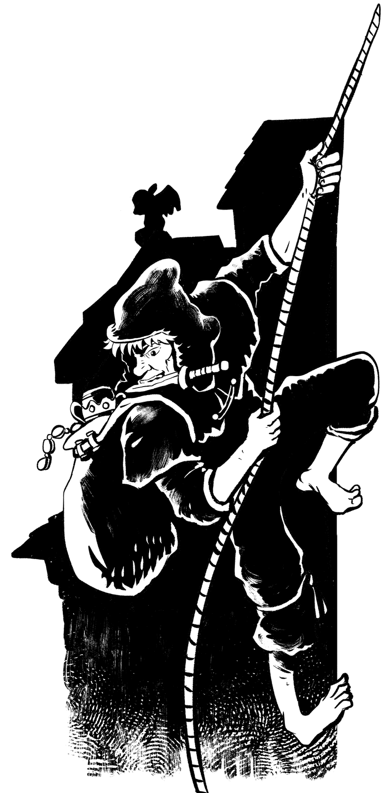

28
Names: Arlo, Lyra, Eamon, Salina, Elara, Freya, Bull, Sparrow, Ivy, Silas
You live in the grey space between those who have power and 
those who don’t. You find opportunity where others see 
only chaos. With nimble fingers, you unburden both the 
richest merchant and the lowliest guard.
Starting Gear
-  3d6 Gold Pieces
-  Rations (3 uses)
-  Torch (3 uses)
-  Twin Daggers (d6+d6, bulky)
-  Padded Leather (1 Armor)
-  Lockpicks
-  Black Outfit (petty)
Cutpurse
BACKGROUND 5

---
## p.29

29
d6
What was your last big job?
1
A noble’s summer home. The place was full of fancy wine (+20gp) but not 
much else. Take Fence Cutters.
2
A bank. (You were caught.) You bear a brand only visible by firelight, and 
anyone who sees the mark can ask you for a beer. Take Retractable Wires.
3
A guild warehouse. Take a Ladder (bulky, 10ft) and Blinding Powder (1 
use).
4
Moneylender. Someone beat you to the job but left behind a Scroll of 
Arcane Eye (petty).
Arcane Eye: You can see through a magical floating eyeball that flies around 
at your command.
5
Constable’s quarters. You escaped but left some friends behind. Take 
Strong Silk Rope and a queasy feeling.
6
A university. You were seen but not pursued. You still don’t know why. 
Take Smoke Pellets (3 uses).
d6
What helps you steal?
1
Catring
2 charges. Climb up walls and fall safely. Recharge: Place 
the ring on a stray cat’s tail.
2
Gildfinger
1 charge. A finger glove that mimics any mundane key. 
Recharge: Bundle it with at least 100gp for a night.
3
Glimpse 
Glass
3 uses. A monocle that lets you see through walls or other 
obstructions. It shatters after the last use.
4
Sweetwhistle
1 charge. Listeners hear a soft, familiar voice in the 
distance that they cannot resist following. Recharge: Lose 
a dear memory. (Describe it.)
5
Vagrant’s 
Veil
1 charge. Wear it to blend seamlessly into crowds, 
appearing as a simple pauper. Recharge: Donate all the 
day’s winnings to the poor. Petty.
6
Reverse 
Teetotum
1 use. When spun, time skips backwards 30 seconds. 
Everyone remembers what happened.

---
## p.30

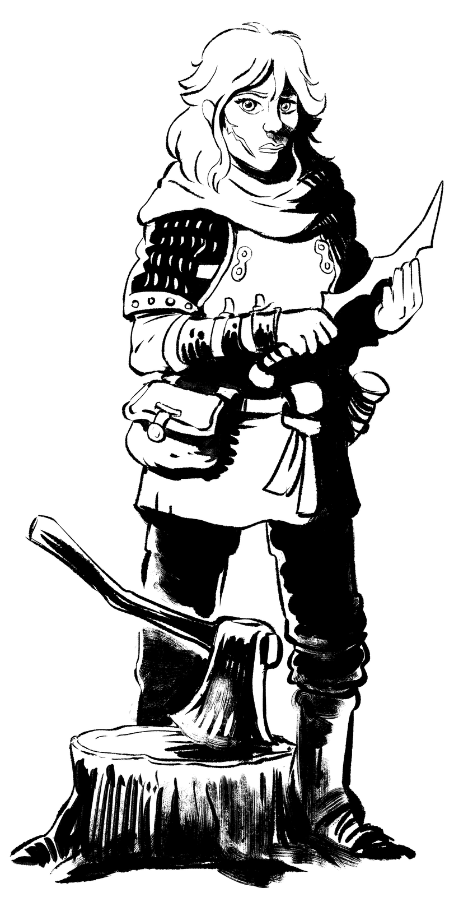

30
Names: Seed, Thresh, Dibber, Sow, Stalk, Harrow, Cobb, Flax, Briar, Rye
Protectors of the harvest, defense against pests, thieves, and beasts. A position of 
great honor, while it lasts: many guardians do not live out their natural lives. 
Roll a second time on the Bonds table.
Starting Gear
-  3d6 Gold Pieces
-  Rations (3 uses)
-  Torch (3 uses)
-  Brigandine (1 Armor, bulky)
-  Sling (d6)
-  Hand Axe (d6)
-  Repellent (pick the type, 3 uses)
Fieldwarden
BACKGROUND 6

---
## p.31

31
d6
What got the better of you?
1
A voracious swarm of pests that swallowed crops and animals alike. With 
nothing to defend, you left. Take Gale Seed Extract (3 uses). Ingesting it 
lets you sprint with a speed four times your regular rate. Afterward you 
add two Fatigue.
2
A crop spirit, angered by a poor tithing. The fires consumed nearly 
everything, and afterward you were able to gather a pouch of Fireseeds 
(d8, blast, 4 uses).
3
An antlered, toothy demon that nearly ended you. Take a blood-stained 
bone knife (d6). On Critical Damage, its next attack becomes enhanced 
from contact with blood.
4
The Withering, a type of stem rot from the Roots. Take a Diseased Crop (6 
uses) that decays any plant it touches.
5
Wolves, or so you thought. You are now a Werewolf [8 HP, 15 STR, 14 DEX, 
claws (d6+d6), bite (d8)]. Your WIL remains the same. You can turn at will 
(once per day) but must make a WIL save to revert. Anyone left alive from 
your attacks must make a WIL save to avoid infection.
6
Crop thieves. Not all of them survived, but you were outnumbered. Start 
with +d4 HP and a Cusped Falchion (d8).
d6
What tool saved your life?
1
Bloodvine 
Whip
d8 damage. On Critical Damage, it drains the target’s 
blood, granting the weapon’s next attack the blast quality.
2
Clatter 
Keeper
A hand-cranked device that emits a loud noise, frightening 
away most creatures.
3
Sun Stick
Provides ample warmth and light for up to one hour (1 
use). Recharge: Leave in heavy sunlight for a full day.
4
Root Tether
When thrown, binds a creature as large as a wolf to the 
soil for a short time.
5
Greenwhistle
A small flute that calms plants, making passage through 
areas heavy with plant life a bit easier.
6
Everbloom 
Band
A circlet adorned with flowers that never wilt. On Critical 
Damage, the flowers dissolve into dust, but you act as if 
your save succeeded (STR loss still occurs).

---
## p.32

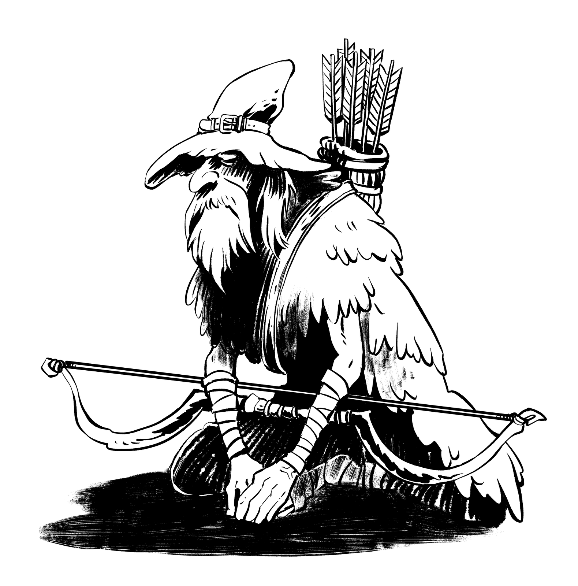

32
Names: Flint, Feather, Crier, Thunder, Falcon, Pluck, Needle, Warsong, Hawk, Cai
You strike from afar, but that does not make you a coward. You are a musician, 
the song of your bowstring nought but a warning, singing the silent promise of a 
quick death.
Starting Gear
-  3d6 Gold Pieces
-  Rations (3 uses)
-  Torch (3 uses)
-  Bow (see table)
-  Serrated Knife (d6)
-  Boiled Leather (1 Armor)
-  Heartroot Salve (restores 1d4 STR, 1 use)
Fletchwind
BACKGROUND 7

---
## p.33

33
d6
What kind of wood is your bow made from?
1
Western Yew (d6, bulky). Can be wielded as a blunt weapon (d6). Noisy.
2
Sessile Oak (d8, bulky). Slams into targets. On Critical Damage, something 
is torn off.
3
Stone Pine (d6, bulky). Produces one use of Sticky Sap per day. The sap is 
highly explosive.
4
White Ash (d6, bulky). Can be used in place of a shield in melee combat (+1 
Armor).
5
Striped Bamboo (d6). Collapsible, it only requires one slot (but still 
requires both hands).
6
Wych Elm (d6, bulky). Protects the bearer from poisons and toxins, so 
long as they are holding it.
d6
How did you earn your bow?
1
War.  If you are first to attack, your bow gains the blast property for the 
first round.
2
Falconry.  You keep a falcon [3 hp, 5 STR, 16 DEX, 4 WIL, claws (d6+d6), 
bite (d8)]. It only eats live game.
3
Hunting.  When taking the Supply (pg. 79) action, your ability to secure 
Rations increases by one step (e.g. 1d4 becomes 1d6).
4
Tournaments.  Attacks with your bow are enhanced if the target is 
immobile.
5
Training.  If you are the first to attack, melee attacks against you are 
impaired until you take STR damage.
6
Scouting.  When taking the Travel (pg. 79) action, your presence decreases 
the chance of getting lost by one step (e.g. 4-in-6 becomes 3-in-6).

---
## p.34

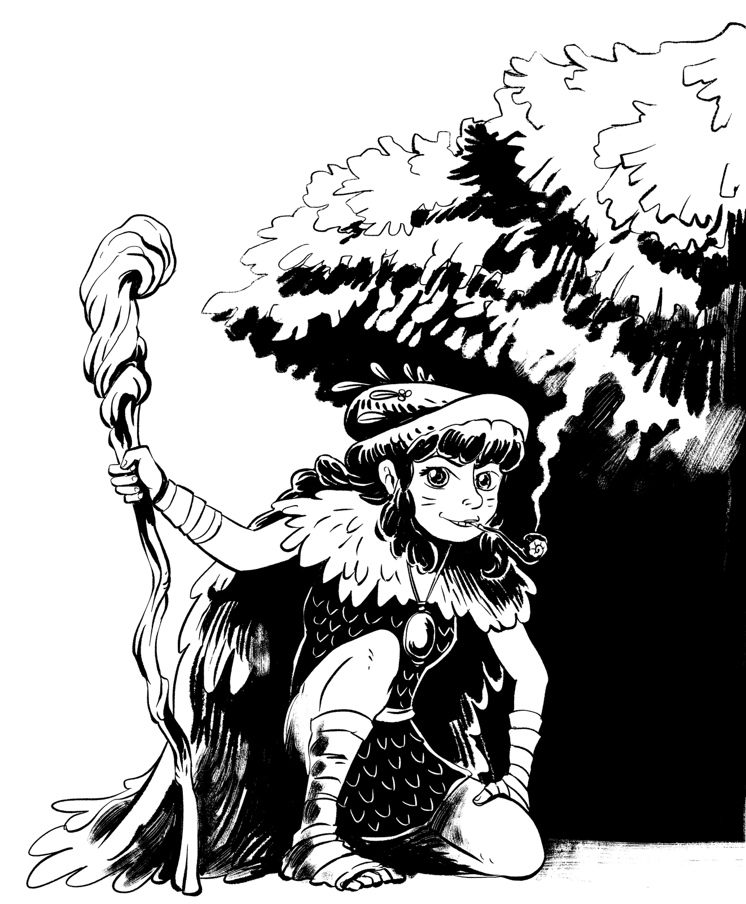

34
Names: Faunus, Snowdrop, Wisp, Silverdew, Brim, Solstice, Steeleye, Artea, 
Gossamer, Hazel
An odd birthmark, a strange smell: somehow, the touch of elsewhere still lingers. 
Wherever you are, you have trouble fitting in. Roll on the Omens table (even if 
you’re not the youngest player), but keep the results private for now.
Starting Gear
-  3d6 Gold Pieces
-  Rations (3 uses)
-  Torch (3 uses)
-  Salt Pouch
-  Heirloom Amulet (petty, glows in the presence 
of magic)
-  Sling (d6)
-  Dagger (d6)
Foundling
BACKGROUND 8

---
## p.35

35
d6
Who took you in?
1
An old hunter. You were both quite happy, until it all ended. Take a 
Weathered Longbow (d8, bulky) and a Leather Jerkin (1 Armor).
2
A wizened apothecary, who taught you the healing arts but maintained a 
clinical detachment. Take a Healing Unguent (restores d4 STR, 1 use).
3
A druid, who taught you the language of trees. When it came time to leave, 
you took with you only a Gnarled Staff (d8) and left a promise that one 
day you would return.
4
A gruff blacksmith from a sleepy river town. You were always kept at arm’s 
length. Now the forge is cold, and you’ve moved on. Take a Smith’s Apron 
(petty) and a set of oft-mended Chain Mail (2 Armor, bulky).
5
A troupe of traveling entertainers. For a time, they were like family to you. 
One day you woke up and they were gone with no explanation. Take a 
Storybook, a Dagger (d6), and some burning questions.
6
The monks of a secluded forest monastery. When their rules became too 
strict, you snuck away. Take a Monk’s Habit (warm, petty) and a Spellbook 
of Control Plants.
Control Plants: Nearby plants and trees obey you and gain the ability to 
move at a slow pace. Leaves grow along the spine, and it smells faintly of 
decay.
d6
What keeps away bad tidings?
1
Pipeweed
Your good luck charm. Conversations tend to flow more 
easily after a smoke (6 uses).
2
Stink Jar
Shattering this jar releases an odor so foul all nearby must 
make a STR save or immediately vomit (1 use).
3
Ivy Worm
A green worm often mistaken for a weed. Swallowed 
whole, it absorbs any toxins or rot in the body before 
exiting through the usual way.
4
Dream Stone
A smooth blue stone that helps recall dreams more clearly. 
Overuse can cause dream-addiction.
5
Drowning 
Rod
A finger-sized wooden stick that doubles in size each time 
it is fully submerged in water. It doesn’t shrink back down.
6
Rabbit’s Foot
You were wearing it when they found you. They say it is 
the foot of she who left you and that it protects you from 
witch magic (petty).

---
## p.36

36
Names: Unther, Woozy, Hilda, Current, Leif, Ratan, Mourella, Lal, Per, Madrigal
You follow the whisperings of the deep earth, the rhythmic pulse of the mycelium 
forest that grows beneath the surface. The dark holds no terror for you. Also, you 
really love mushrooms.
Starting Gear
-  3d6 Gold Pieces
-  Rations (3 uses)
-  Sharpened Trowel (d6)
-  Candle Helmet (+1 Armor, dim, 6 uses)
-  Rope (25ft)
-  Metal Pail
Fungal Forager
BACKGROUND 9

---
## p.37

37
d6
What strange fungus did you discover?
1
Shrieking Trumpet. When exposed to light, it screams so loudly that all 
nearby attacks (including your own) are impaired (2 uses).
2
Torch Fungus. When crushed, it creates a cold blue light for a short while. 
(2 uses).
3
Murderous Truffle. Pungent, highly toxic, and very rare (worth 50gp to 
assassins). Illegal pretty much everywhere (1 use).
4
Hellcap. Exposure to its aroma causes intense nausea, even vomiting. 
Either way, it clears the room. Bottled (1 use).
5
Sproutcup. Ingest to shrink down to the size of a mouse. (Your belongings 
stay the same size.) You return to normal size within the hour, often in fits 
and starts (1 use).
6
Rootflower. A white fungus found only on corpses deep underground. 
Ingest to restore d6 WIL. You will dream of the dead and their stories 
(1 use).
d6
What keeps you sane, even in utter darkness?
1
Glowsnail
Casts a soft, bioluminescent light. Feeds on one ration 
every two days.
2
Silk Moth 
Shawl
A weatherproof blanket, it can also douse a fire without 
being damaged.
3
Milkflower
A gentle stimulant. Chewing it makes you immune to 
panic for the next hour (3 uses).
4
Luxcompass
Hums softly as it moves closer to the Sun. Eventually the 
noise becomes unbearably loud.
5
Sloth-Tarp
A tough and weatherproof fabric, useful for hanging off 
trees. When inside, you have +1 Armor.
6
Miner’s 
Grease
Great for dislodging a gem, tool, or limb from a tight 
crack. Highly explosive (3 uses).

---
## p.38

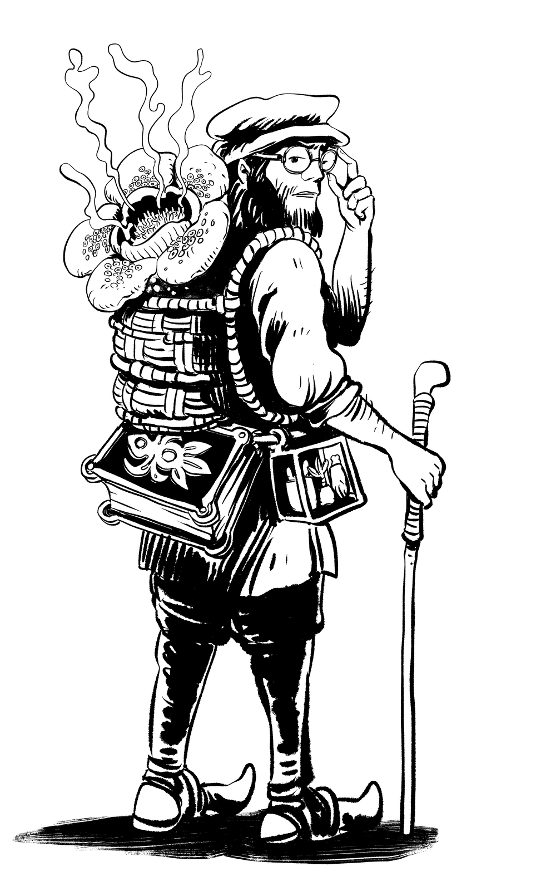

38
Names: Gunther, Moss, Fern, Lichen, Root, Willow, Sage, Yarrow, Rowan, Ash
You delve deep into the Wood, prying its secrets from between rough boughs 
and whispering leaves. To this verdant kingdom, you are no mere scholar but its 
confidant as well.
Starting Gear
-  3d6 Gold Pieces
-  Rations (3 uses)
-  Torch (3 uses)
-  Iron Pot
-  Root Knife (d6)
-  Healing Salve (restores 1d4 
STR, 1 use)
-  Twine Bauble (petty, Ward 
once per day) 
Ward: A silver circle 50ft 
across appears on the ground. 
Choose one species that cannot 
cross it.
Greenwise
BACKGROUND 10

---
## p.39

39
d6
How has the Wood failed you?
1
An ill-tempered forest spirit cursed you for stealing, marking you as an 
enemy of their kind. Take a Bezoar Stone. Ingesting it cures any poison 
(1 use, unless retrieved).
2
A close friend disappeared into the forest. Now you see their face in any 
tea you brew. Take a Soporific Concoction (3 uses).
3
You were poisoned, losing your sense of taste and smell. You can now 
withstand noxious fumes and always carry Antitoxin (2 uses).
4
Your radical experiments turned your skin green, and you now gain 
nourishment as a plant. You don’t need rations, but a day without 
sufficient sunlight and water leaves you deprived.
5
Your impressive corpseflower won a local contest, then promptly killed a 
judge. You fled, but not without the Prize Money (100gp) and a warrant 
for your arrest.
6
You created a restorative tincture that also causes accidental infertility. 
Take a Healing Potion that completely restores STR. Only you know of its 
unintended side-effects.
d6
What keeps you safe while in the Wood?
1
Amadou
A vermilion fungus that catches fire quite easily (3 uses).
2
Delphinium
Breathe water for up to one hour (1 use, but can be divided 
into fractional doses).
3
Tacky Stalk
A woody reed that hardens into a permanent adhesive 
when chewed (2 uses).
4
Wisp 
Lantern
Caged in wrought iron, provides a dim light so long as the 
wisp is able to feed on nearby pain and fear.
5
Seed Bomb
A canvas sack filled with seeds that explode on impact. d6 
damage (blast, 3 uses).
6
Briarvine
Entangles any creature up to horse size (STR to break 
free, reusable).

---
## p.40

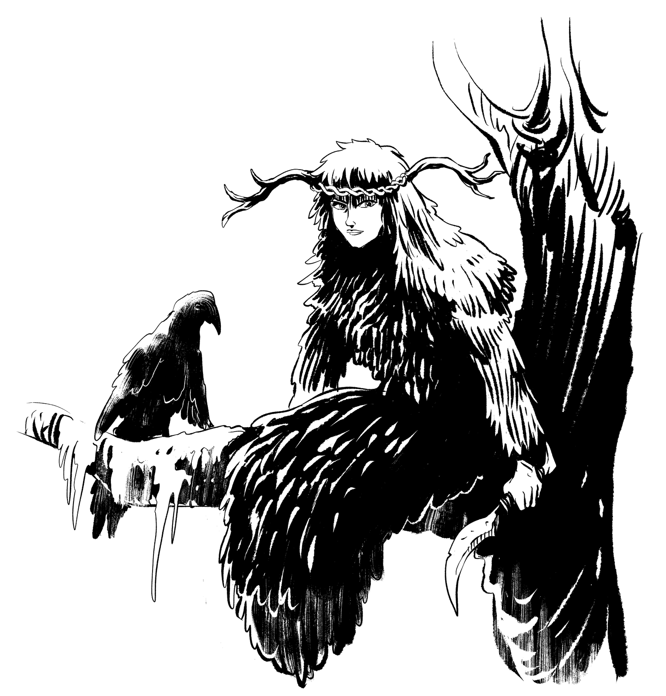

40
Names: Solena, Veles, Bryn, Sabine, Razvan, Rowena, Galen, Nyx, Vex, Iwan
Half Witch
Born of both the mortal world and the unseen, you are an enigma to some and 
feared by many. Yours is the tale of what happens when two worlds collide.
Starting Gear
-  3d6 Gold Pieces
-  Rations (3 uses)
-  Torch (3 uses)
-  Spellbook (Thicket: A thicket of trees and dense brush 
up to 50ft wide suddenly sprouts up. Wrapped 
in vines that must be destroyed again with 
each use.)
-  Iron Dagger (d6)
-  Herbs Pouch (restore 1 STR, 3 uses)
-  Ghillie Suit
BACKGROUND 11

---
## p.41

41
d6
What did you bring back from the Unseelie court?
1
A Black Rose Fiddle (bulky). Its music causes intense sadness and 
immobility in nearby mortals. (Others are merely fascinated.) You don’t 
know how to play.
2
Paper Legs. You are extremely light and can fall a few stories without 
getting hurt. Try to avoid tearing them or getting them wet.
3
A Living Nightmare that dwells within you but manifests whenever you 
are in danger. It has your same Attributes and HP and attacks with claws 
(d8+d8). It disappears on Critical Damage (take 1d4 WIL damage), re-
appearing again on the next full moon.
4
A Raven Familiar [8 HP, 3 STR, 11 DEX, 13 WIL, beak (d6)]. It speaks as an 
intelligent being and is entirely devoted to you.
5
A Briar Thorn. It can pierce any organic material (quite painfully) but 
when removed leaves no trace of the intrusion.
6
A Fae creature’s True Name. Use it to summon its owner for an act of 
great service, but only once. It could also fetch a hefty price, from the 
right buyer.
d6
What concoction do you carry, and what rare ingredients did you 
gather to make it?
1
Rebirth Ash
Remnants of a bark spirit. Sprinkle to reignite a fire that 
has died or return to life a creature that has died only 
moments before (3 uses).
2
Glamour 
Feather
Plume of a firebird. Can make any creature appear 
convincingly as someone (or something) else (1 use).
3
Hawthorn 
Seed
An acorn from the other side, gathered on the spring 
equinox. When planted, it sprouts a luxurious shelter, 
collapsing at moonrise the next day (1 use).
4
Stonetree 
Sap
Sap obtained in exchange for blood. Hardens when rubbed 
on any surface (+1 Armor, 3 uses).
5
Nightdust 
Powder
Made from the ritual burning of six owls. When tossed in 
the air, day turns to night for a short while (2 uses).
6
Hex Stone
Gathered from a river that flows from the other side. 
Removed from its iron tin, it can absorb the effects of 
an active magical effect. If destroyed, the magic is 
released (1 use).

---
## p.42

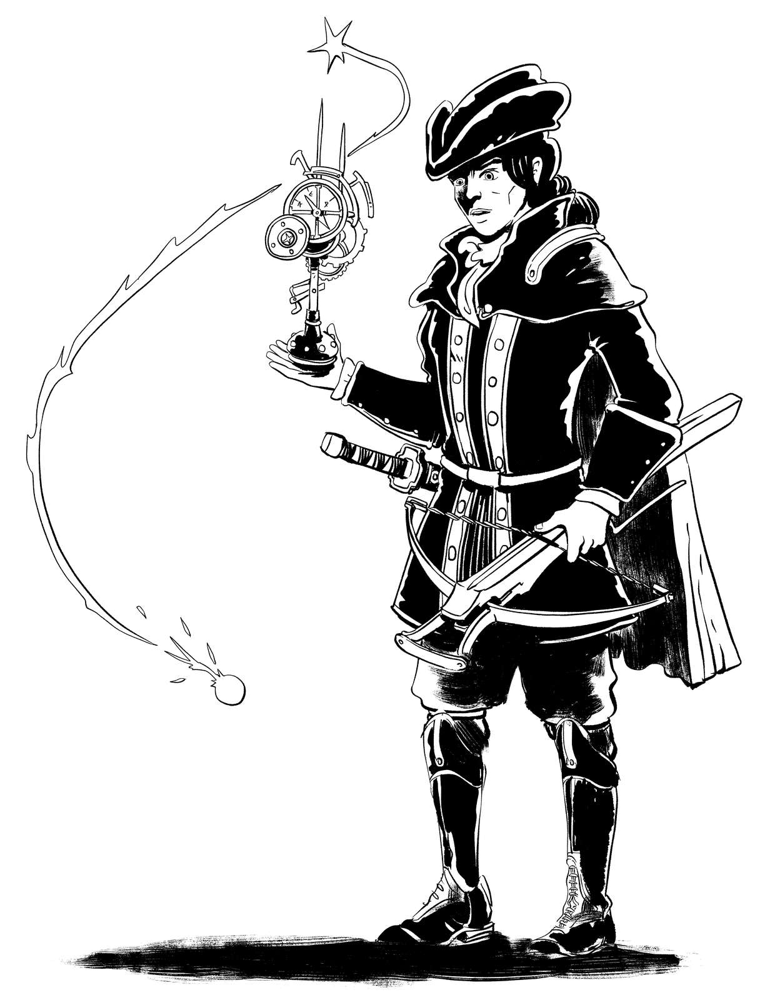

42
Names: Percival, Felix, Isolde, Wolfram, Aldric, Eira, Oswin, Ivor, Brunhilda, 
Beatrix
You are a mere digit on the unerring hand of justice. You go where others fear to 
tread, unyielding and unbroken.
Starting Gear
-  3d6 Gold Pieces
-  Rations (3 uses)
-  Torch (3 uses)
-  Vestments of the Order (petty)
-  Blessed Tinctures
-  Silver Knife (d6)
-  Crossbow (d8, bulky)
Hexenbane
BACKGROUND 12

---
## p.43

43
d6
To which order do you belong?
1
Order of the Crossroads. Take a Pocket Leyfinder. It points to nearby ley 
lines and other sources of arcane power. If you lose it, the punishment is 
death.
2
Order of the Bleeding Star. Take a Star-Iron Mace (d8). It shines faintly in 
darkness and becomes very hot in the presence of witchcraft.
3
Order of the Glass Sigil. Take a Short Sword (d8) and Chainmail (2 Armor, 
bulky). You have contacts in most towns (the more rural, the better) 
willing to provide aid, food, or even weapons.
4
Order of the Blank Eye. Take a Voidglass Shard. Peer through it to see 
invisible marks, creatures, and other magical effects. Lose the use of your 
eye for an hour afterwards (you are deprived).
5
Order of Canaas. Once per day, you can change into a wolf. Take a 
Quicksilver Chain. Without it, you are unable to shift back.
6
Order of the Silent Veil. Take a Quell Stone (2 uses) wrapped in burlap. 
Extinguishes any nearby flames once exposed to air.
d6
What was your vow?
1
Honesty
Choose a weapon type (blunt, blade, etc). Attacks against 
you of this type are impaired. If your vow is broken, you 
lose d4 WIL.
2
Poverty
You carry the Disassemble Spellbook. Only you can use it. 
If your vow is broken, it explodes (d12 STR damage).
Disassemble: Any of your body parts may be detached and 
reattached at will, without causing pain or damage. You can 
still control them. Regenerates any torn or defaced pages.
3
Selflessness
You are immune to magical effects such as charm, hatred, 
frenzy, and so on. If you break this vow, you lose d6 WIL.
4
Mercy
Choose a weapon type (blunt, blade, etc). Attacks with 
this weapon are enhanced. If your vow is broken, you can 
never use that weapon type again.
5
Charity
Once per day, you can shrug off a Fatigue. If your vow is 
ever broken, you permanently lose one inventory slot.
6
Valor
The first time you inflict Critical Damage, you receive +d4 
HP, returning to the previous limit at the end of combat. If 
your vow is broken, you die.

---
## p.44

44
Names: Jax, Selene, Baladria, Ada, Mort, Saylor, Tripp, Lantos, Echo, Jubilo
What inspires the soul more than song, words, and spectacle? Why practice for 
years to master the arcane when you’ve already got real magic inside?
Starting Gear
-  3d6 Gold Pieces
-  Rations (3 uses)
-  Torch (3 uses)
-  Costume
-  Simple Instrument (Pipes, Lute, etc.)
-  Lucky Jerkin (+1 Armor)
-  Sling (d6)
Jongleur
BACKGROUND 13

---
## p.45

45
d6
What happened at your final performance?
1
Despite your training in the deadly arts, an actor died and you were 
blamed. Take a light-weight Rapier (d6) and a false identity.
2
The crowd loved your catchy tune about a noble and his romantic failings. 
Take the Read Mind Spellbook and a warrant for your arrest.
Read Mind: You can hear the surface thoughts of nearby creatures. Long-
term possession can cause the reader to mistake the thoughts of others as 
their own.
3
Your debut composition reduced the audience to a gibbering mess, 
murmuring of bright creatures descending from the night sky. Later you 
noticed that the notes resembled stellar constellations. Take a Book on 
Astronomy and a lot of questions.
4
You mocked a forgotten trickster god and were cursed for it. You speak 
only in perfect rhyme. Ironically, this has only made you more popular 
among your peers. Take a Thesaurus (20gp). Without it, you are deprived.
5
You were scarred in an on-stage accident. The crowd cheered, thinking 
it was part of the act. Take well-worn Stage Mail (1 Armor), a memorable 
scar, and a fear of applause.
6
Your respectable puppeteering skills were matched only by your mimicry. 
You were so good you were branded a witch (literally) and banished. Take 
an Uncanny Hand-Puppet and a Rabbit Skull (petty) that protects against 
charms.
d6
What trinket were you unable to leave behind?
1
False Cuffs
Comfortable, realistic-looking cuffs. Only you know the 
trick to get out of them.
2
Pocket 
Theatre
A set of small puppets and a folding stage. Good for quick 
distractions.
3
Ghost Violin
A dark-gray violin that plays a haunting tune, mirrored by 
an invisible, distant twin.
4
Tragic Tales
Banned in proper company, this book becomes less bawdy 
and more harrowing towards the end. Worth 100gp.
5
Mythos Mask
A plaster mask that allows one to take on a monster’s 
countenance. Once it comes off, add a Fatigue.
6
Rebreak 
Glass
A wine flute that can be broken multiple times, reforming 
after 24 hours. Makes a really loud noise.

---
## p.46

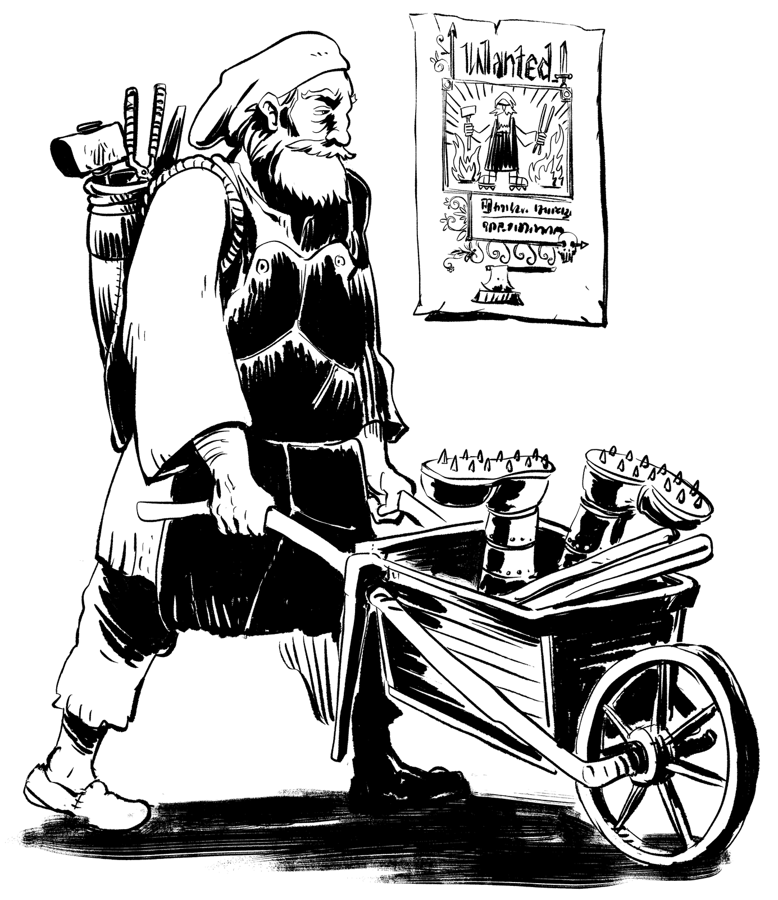

46
Kettlewright
You are known by the smell of molten metal and the jingle of tin. You are no mere 
merchant but an artisan of fire and metal.
Starting Gear
-  3d6 Gold Pieces
-  Rations (3 uses)
-  Torch (3 uses)
-  Pincers
-  Roll of Tin
-  Gloves (petty)
-  Hammer (d6)
Names: Fergus, Eon, Bram, Idris, Hester, Darragh, Seren, Rónán, Berek, Lorenz
BACKGROUND 14

---
## p.47

47
d6
What is your trade?
1
You build small contraptions for local guilds (and don’t ask too many 
questions). Take an extra 40gp and a wanted poster with your face on it. 
Given time and materials, you can open almost any door or vault.
2
You deal in home goods and tools, hawking your wares to townspeople 
across the lands. Take 20gp of items from the gear table. You are fluent in 
the Traveler’s Cant.
3
You were a military smelter, before peace destroyed your livelihood. Take 
a Smelting Hammer (d10, bulky) and a Tin Helm (+1 Armor). Given time 
and adequate materials, you can repair armor.
4
You sell rare and quality items to monasteries and nobles alike. Take a 
Spyglass, a Necklace (petty) worth 20gp, and a Scroll of Mirrorwalk (petty).
Mirrorwalk: A mirror becomes a gateway to another mirror that you looked 
into today.
5
You offer protection as a service, quietly watching for threats as money 
exchanges hands. You start with +d4 HP, and carry a Long Sword (d10, 
bulky) and a Gambeson (+1 Armor).
6
You scavenge raw tin and iron from battlefields, pulling teeth from still-
twitching corpses. Start with a young Donkey (+4 slots, slow), a Crossbow 
(d8 damage, bulky), and a Saw (d6).
d6
What never fails to get you out of trouble?
1
Fire Eggs
Six small pellets made of sea salt, wood, and crockery-
dust. They explode at low heat (d8, blast) but the flames 
dissipate quickly.
2
Black Tar
Versatile: both sticky and highly flammable (3 uses).
3
Spiked Boots
Cracks heads (d8) as easily as it does ice and muck. Travel 
is also a bit slower, but easier.
4
Tinker’s 
Paste
Seals shut any fist-sized opening (3 uses).
5
Fireworks
A dazzling albeit dangerous display. Enough explosive 
material to blow off a finger or three (2 uses remain).
6
Carrion Cat
A clever pet, small enough to hide in your pack (bulky), 
strong enough to scare off smaller predators. Requires 
one Ration a day, and it must be meat. 3 HP, 5 STR, 15 
DEX, 12 WIL.

---
## p.48

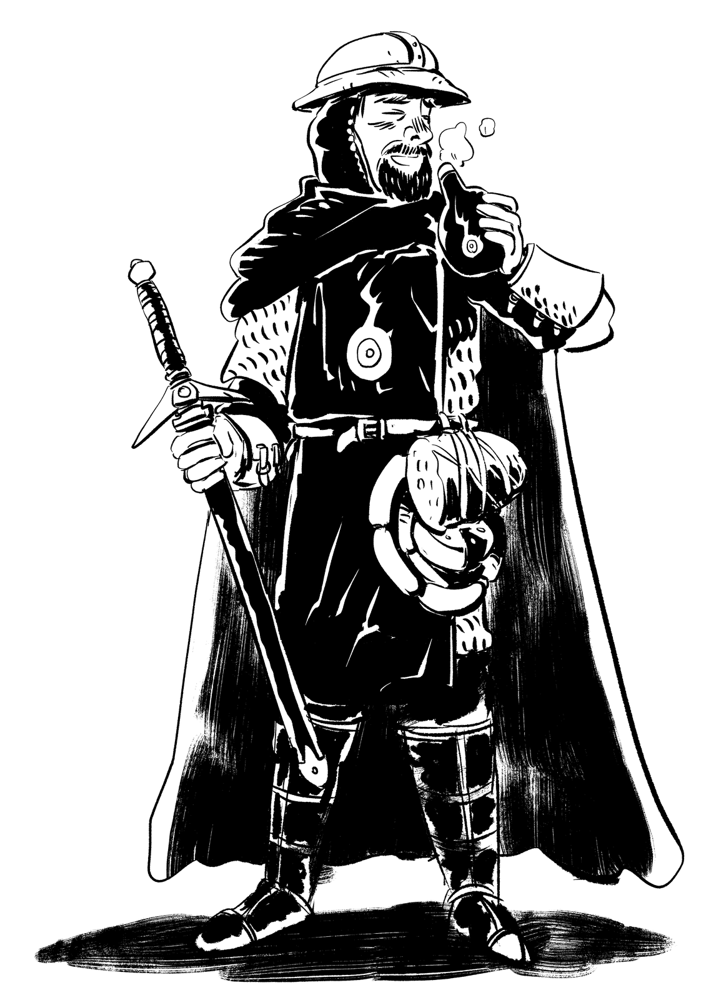

48
Names: Gann, Light, Saoirse, Frost, Thorn, Reed, Dirk, Ragnar, Brie, Aasim
Bound by blood Oath to patrol the border and protect the realm. Once sworn, the 
Oath cannot be broken. The Guard always finds their own.
Starting Gear
-  3d6 Gold Pieces
-  Rations (3 uses)
-  Lantern
-  Oil Can (6 uses)
-  Long Sword (d10, bulky)
-  Boiled Leather (1 Armor)
Marchguard
BACKGROUND 15

---
## p.49

49
d6
Why did you take the Oath?
1
Your family has a long tradition of serving, and you were trained from an 
early age on how to survive in the wild. When taking the Supply (pg. 79)
action, your yield increases by one step (e.g. 1d4 > 1d6).
2
As a convict, the Oath was simply a means of avoiding punishment. Take a 
set of Lockpicks and the Key (petty) to a safehouse.
3
Noble-born, you joined to escape family trouble. Take a Goosefelt Tarp 
(fits two) that you stole before leaving home.
4
When your family lost everything, you took the Oath to avoid becoming a 
burden. Take extra Rations (3 uses) and Throwing Knives (d6).
5
Your life was saved by a member of the Marchguard, and you were 
inspired to join their ranks. Take a Snare Trap and a Sketchbook filled 
with detailed drawings.
6
You were in a dark place and decided that your life needed a little 
direction. You’re still not so sure it was the right choice. Take an Oilskin 
Coat and Mapping Paper.
d6
What do you carry as proof of your Oath?
1
Impressive 
Pin
A metal badge of honor from the Guard. It can open doors 
but leaves a trail (petty).
2
Oath 
Compass
Points not towards North, but instead to the nearest 
member of the Guard. It also lets you know when they’re 
getting close.
3
Pullstones
Two jet-black stones. When separated, the stones will 
always roll toward one another.
4
Fireflask
Highly alcoholic, yet strangely delicious. When thrown, it 
creates a wall of flames 10ft high that burns out after a few 
minutes (1 use).
5
Pain Band
Touch an injured creature to transfer their wounds to 
you. (Exchange their lost STR with your own.) Recharge: 
Wear the ring while in perfect health. You will lose 1 STR, 
permanently. (petty)
6
Poacher’s 
Woe
Strongly-scented arrows (3 uses). The scent is powerful 
enough to track with ease.

---
## p.50

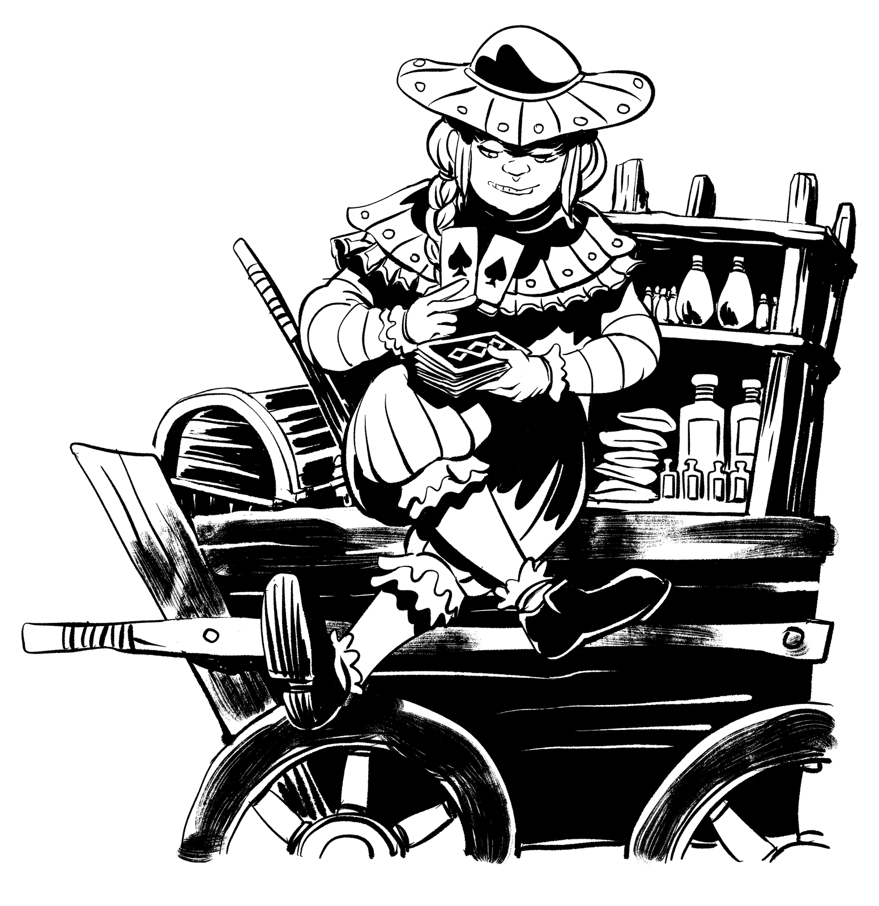

50
Names: Ambrose, Lucius, Beauregard, Cornelius, Aria, Toph, Indigo, Delphine, 
Solene, Noa
Wits are your sharpest weapon, a facade your strongest shield. But when you do 
lose, you lose badly.
Starting Gear
-  3d6 Gold Pieces
-  Rations (3 uses)
-  Torch (3 uses)
-  Cart (+4 slots, bulky when pulled)
-  Trick Playing Cards
-  Fancy Hat (petty)
-  Cane Sword (d6)
Mountebank
BACKGROUND 16

---
## p.51

51
d6
How was your fraud exposed?
1
Your “patients” kept reporting miraculous recoveries, despite your lack of 
training. Start with Bandages (3 uses) and a knack for healing.
2
After seducing a wealthy patron, their family hired a criminal gang to 
retrieve you. You got away and need to lay low. Start with Beauty Cream 
(2 uses). Apply to appear irresistibly beautiful for the next 12 hours.
3
You were a peddler of fake prophesies, but when one turned out to be 
true, it drew unwanted attention. Roll on the Omens (pg. 14) table, but 
keep the result to yourself. Start with a concealable Knife (d6, petty).
4
Your latest stunt destroyed a priceless artifact and injured a dozen 
bystanders. Start with a Captain’s Uniform (petty), a Ceremonial Sword 
(harmless, 60gp), and a Bouquet of Flowers.
5
You were cursed by a hedgewitch for fooling some innocent village folk. 
Magic acts unpredictably in your hands (WIL save to avoid disaster). If you 
are the target of magic, the same applies to its wielder.
6
Your “seances” with the dead were in actuality a ruse involving a cleverly 
hidden Spellbook of Auditory Illusion. Inevitably, a patron discovered your 
secret. Start with the spellbook and a Bundle of Scarves.
Auditory Illusion: You create illusory sounds that seem to come from a 
direction of your choice. Produces random and occasionally inopportune 
sounds throughout the day.
d6
What keepsake could always identify you?
1
Royal Crest
Born into royalty, you chose a different life. The crest 
grants you access but also alerts your family of your 
whereabouts. 
2
Miracle Oil
A smelly, slippery concoction (2 uses).
3
Surgeon’s 
Soap
A lye and ash block that makes skin temporarily 
transparent, revealing the anatomy within (4 uses).
4
Goat Powder
Derived from the placenta of a baby goat. Temporarily 
cures any affliction, but symptoms return within hours.
5
Cursed 
Sapphire
Worth 200gp, it noticeably returns to your pocket shortly 
after you spend it. You can’t seem to get rid of it.
6
Alchemical 
Tattoo
A dog, cat, or bird that can leave your body on demand. It 
follows your commands to the best of its abilities and can 
pass its injuries (as STR loss) back onto you (petty).

---
## p.52

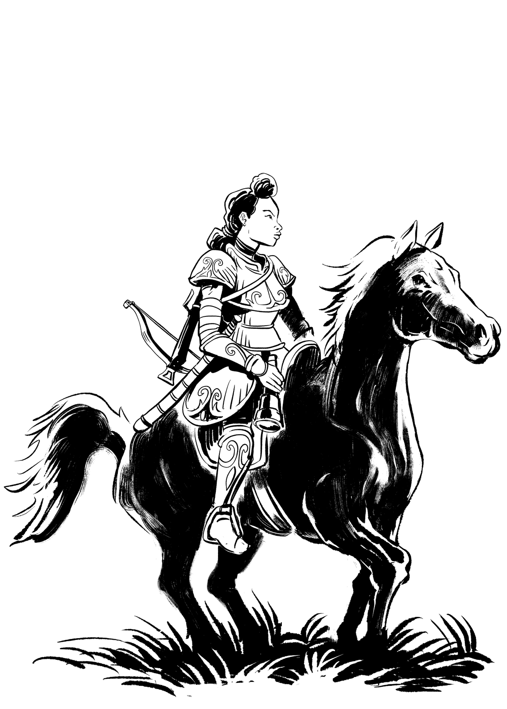

52
Names: Drake, Cyra, Keir, Darius, Valen, Rorik, Yara, Rui, Talon, Jory
Your coin comes from escorting caravans, tracking fugitives, or lending your 
blade to a cause. You’ve been a savior, an executioner, a hero, and even a villain. 
Yours is not a solitary path, however: you’ll always have your horse.
Starting Gear
-  3d6 Gold Pieces
-  Rations (3 uses)
-  Torch (3 uses)
-  Long Sword (d10, bulky)
-  Leather Jerkin (1 Armor)
-  Crossbow (d8, bulky)
-  Spyglass
Outrider
BACKGROUND 17

---
## p.53

53
d6
What personal code or principle do you uphold?
1
No innocent blood: No bystanders will come to harm on your watch. Take 
a Steadymade Buckler (+1 Armor). While holding this shield, you cannot be 
moved so long as both feet are planted on firm ground.
2
Revere the tools of death: Weapons are to be respected and maintained. 
Take a Wyrmbone Whetstone. Following a half-hour ritual sharpening, 
attacks with the weapon are enhanced until STR damage is dealt.
3
To the death, always: You never back down from a fight, no matter the 
odds. Take a Death-Whistle, 1 charge. Its scream frightens away all who 
hear it (save WIL or flee). Recharge: Capture the final breath of a dying 
warrior.
4
Revere the dead: Death is a journey we all take, and it deserves respect. 
Take an extra 30gp. You always place two gold pieces on the eyelids of a 
slain foe. Somehow you always find the coin.
5
Loyalty to the work: Your word is your bond. Once you’ve accepted a job, 
you see it through to the end. Take a weathered Tally Stick. Once a vow is 
marked onto its face, the stick hardens (d8) until it is complete. The stick 
will snap in half if the vow is ever broken.
6
Always pay your debts: You always repay what you owe, whether in coin 
or in kind. You expect nothing less from all others. Take a blacked-out 
ledger, then roll a second time on the Bonds (pg. 12) table.
d6
What breed is your horse?
1
Heavy 
Destrier
A beast built for war, an imposing creature. 8 HP, 1 Armor, 
hooves (d10+d10), +2 slots.
2
Blacklegged 
Dandy
Hardy and adaptable. Tough or Perilous terrain (pg. 75) are 
one step easier. 6 HP. +4 slots.
3
Rivertooth
Impressively strong, capable of carrying heavy loads. 
4 HP. +6 slots (only +2 slots if carrying two people).
4
Piebald Cob
Intelligent, it can understand simple commands and even 
has an instinct for danger. 6 HP. +4 slots.
5
Linden 
White
Highly trained and agile, it can perform intricate 
maneuvers in a time of need (no DEX save to flee). 
4 HP. +3 slots.
6
Stray Fogger
Wild but very fast, even in Tough terrain (pg. 75). Rides 
light. 4 HP. +2 slots.

---
## p.54

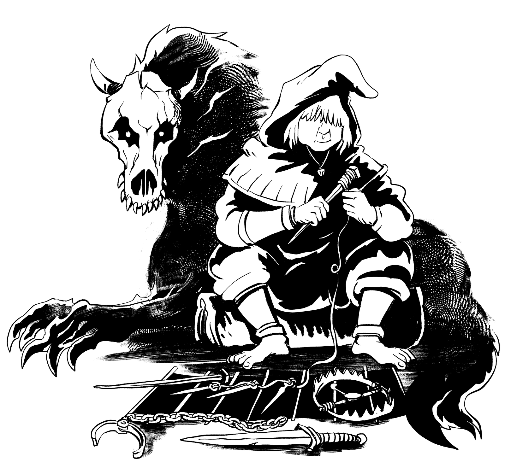

54
Names: Winda, Brielle, Theron, Chayse, Nuja, Dev, Raven, Baruani, Arawan, Sable
You are a specter in the night, a fleeting shadow that slips by its prey, unseen. 
Each kill is a test of cunning and animal determination, a contest between life and 
death. You know that one day you will lose. You look forward to it.
Starting Gear
-  3d6 Gold Pieces
-  Rations (3 uses)
-  Torch (3 uses)
-  Tarp (shelters 1)
-  Boiled Leather (1 Armor)
-  Short Sword (d6)
-  Spring-Loaded Trap (4 STR damage)
Prowler
BACKGROUND 18

---
## p.55

55
d6
What did you last hunt?
1
A mock firefly, baiting water carriers with its lure. Take an Alchemical
Limb (d8, petty when worn) to replace the one it tore off and an Oil Can (6 
uses). The limb is immune to heat and poison. Needs to be oiled daily.
2
An ice nettle, trapping and draining sheep. You lost your commission 
when the fungus you introduced killed half the flock. Take a Rime Seed (1 
use). It freezes any body of water, no matter the size. Don’t eat it.
3
A silver marsh crawler that killed someone close to you. You now carry 
its Tooth (petty) on a chain around your neck as a warning to others of its 
kind. The tooth hums softly when something is stalking you.
4
A malicious forest spirit that poisoned a homestead. You saved a 
Heartseed from the roots of a dying tree. (Plant to create a a new forest.) 
Also, take Iron Bracers (+1 Armor, bulky).
5
A hollow wolf that had been frightening travelers. You took pity on the 
half-starved creature and nursed it back to health. Now it is loyal to you 
unto death. It is also a great tunneler. 5 HP, 11 STR, 13 DEX, 8 WIL, teeth 
(d6).
6
An azure warbler. The gametes attract a sizeable profit, if properly 
extracted. You succeeded but left its nest to the wolves. Take a Paring 
Knife (d6), an extra 20gp, and a pang of regret.
d6
What tool is always in your pack?
1
Fermented 
Spirits
Keeps you warm at the best of times and can be used as 
an explosive at the worst (3 Uses).
2
Trail Shaker
A noisy instrument that reveals nearby trails, even when 
deeply hidden.
3
Drowse Balm
A wax bar. If boiled in water, the steam acts as a soporific 
agent.
4
Spike and 
Cord
For traversing difficult terrain or for creating makeshift 
traps and structures.
5
Iron Rattle
A noisemaker for distracting or scaring your quarry. 
Sounds convincingly like a snake.
6
Hardening 
Glue
Makes any flat material (cloth, leather, sand) as hard as 
stone. Expensive (20gp a bottle, 3 uses).

---
## p.56

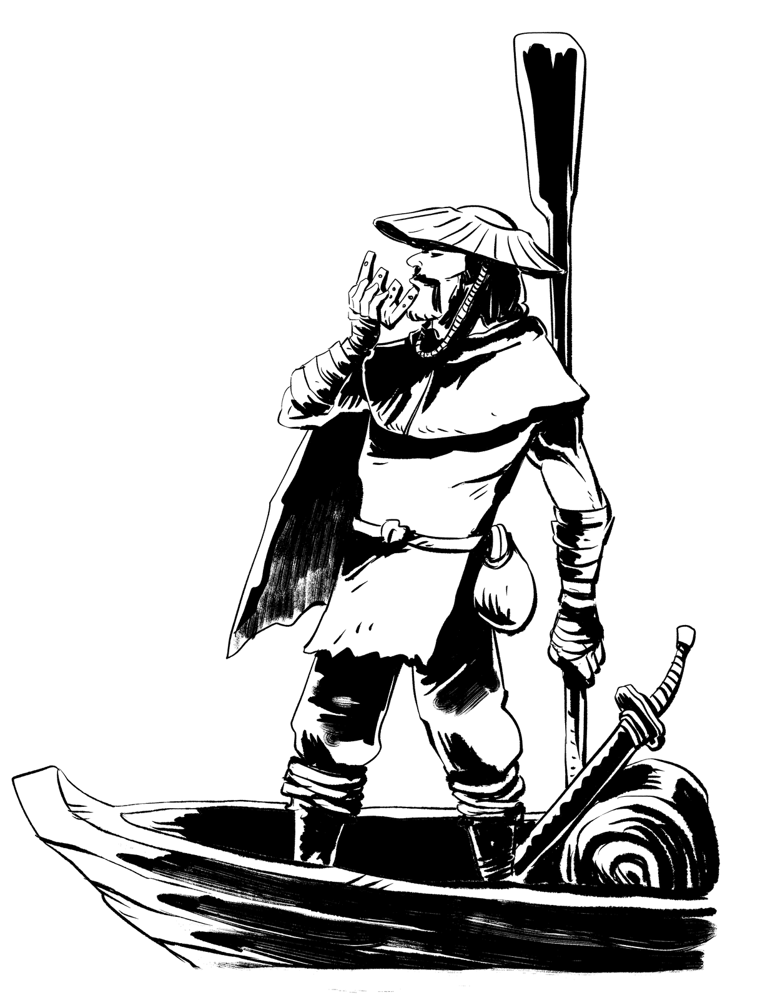

56
Names: Gale, Piper, Brook, Adair, Stone, Dale, Wren, Cliff, Rain, Robin
You sing the stories of rivers and lakes, your talents soothing friends and the 
elements alike. You’ve seen more than most, but somehow it never seems to 
be enough.
Starting Gear
-  3d6 Gold Pieces
-  Rations (3 uses)
-  Torch (3 uses)
-  Water Shoes
-  Brigandine (1 Armor, bulky)
-  Compass
-  Dagger (d6)
Rill Runner
BACKGROUND 19

---
## p.57

57
d6
What songs are you best known for?
1
The Tinker’s Two-Step. A humorous fairy tale about a gift-giving traveler. 
Start with a Reed Whistle. Anyone in earshot must pass a WIL save to 
perform an act of violence.
2
The Sylph and Her Lover. A bawdy tale of lost love. Start with a Breeze 
Knot (3 charges). Creates a strong breeze. Recharge: Tie it to a mast 
during a storm.
3
Harper’s Devotion. A sad, short tale about a musician who falls in love with 
a star. Start with a Celestial Lute. Reveals the constellations above, no 
matter the weather.
4
The Reed Fisher. A celebrated song about a massive carp that always seems 
to get away. Begin with a spool of River Twine (5 uses). Each dip into the 
river guarantees a catch, though it might not be pleasant.
5
Song of the Silver Stream. A wordless lullaby that mimics flowing water. 
Take a Stone Flute that can calm almost any river.
6
The Thrush and the Meadow. A moody tale told in alternating chorus. Start 
with a Feather Quill (1 use, petty). A map drawn with this quill reveals the 
most expedient course between any two points.
d6
What pays your way across the land?
1
Performance
Performing at taverns always yields both room and board. 
Sometimes you even get tips! Start with an extra d6 gold.
2
Bodyguard
You are a protector for those afraid to travel alone. Start 
with a rapier (d8).
3
Wares
You buy low and sell high, always making just enough to 
get by. Take a Single Item worth 20gp or less from the 
equipment table.
4
Transport
You deliver “delicate” packages throughout the lands. You 
have at least one contact in any major town.
5
Sailor’s 
Friend
Over troubled waters and dangerous winds, you always 
make sure a ship reaches its destination. For you, passage 
is always free.
6
Guide
You shepherd caravans and travelers across water-soaked 
lands. Start with a Map relevant to your next journey.

---
## p.58

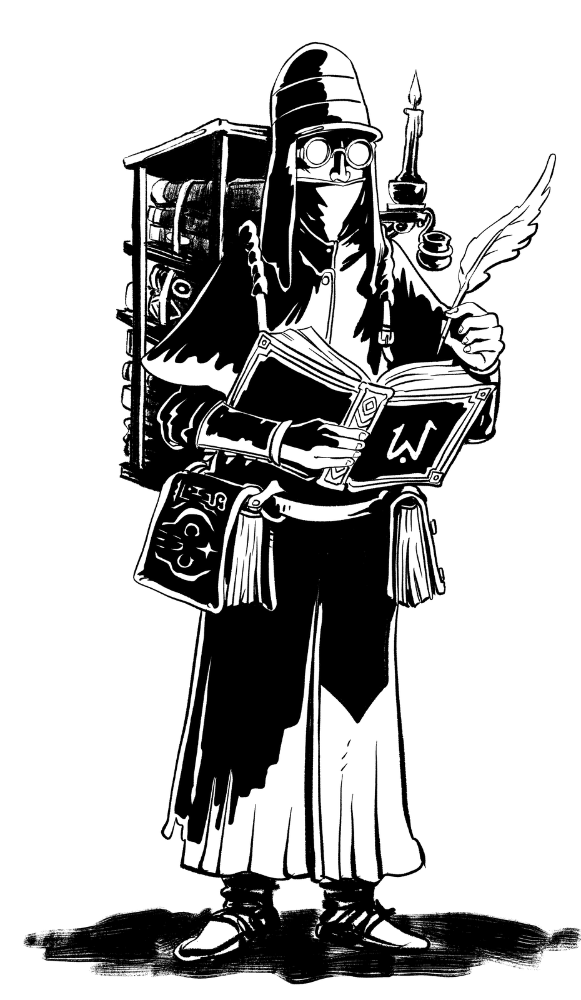

58
Names: Lazlo, Stilo, Akshara, Pisa, Ji-Yun, Kalamos, Hugo, Shui, Kalam, Julius
You copy ancient texts and illuminate manuscripts, recording the voices of the 
clever, the great, and the powerful. You will prove that the pen truly is mightier 
than the sword.
Starting Gear
-  3d6 Gold Pieces
-  Rations (3 uses)
-  Torch (3 uses)
-  Quill & Ink
-  Blank Book
-  Awl (d6)
-  Badge (petty)
Scrivener
BACKGROUND 20

---
## p.59

59
d6
What work did you keep for yourself?
1
The Wild Tongue. A bundle of leather-bound scrolls. A seminal work, 
cataloging the hidden languages of beasts and how to understand them.
2
The Silent Symphony. Bound in fluorescent wrap. Very rare, it chronicles 
the subtle signs used by those employing invisibility magic.
3
A Treatise on the Abyss. A nondescript black book. An in-depth, largely 
theoretical text describing the Roots, as well as information about the 
location of a nearby Gate.
4
The Star Waltz. A comet-shaped clasp bound in a fine leather cover. 
Detailed astronomical charts, celestial movements, and stellar festivals. 
Highly valued (100gp) for its usefulness to travelers.
5
The Cathedral and the Canopy. Large-leaf binding over vellum. Nominally 
a children’s storybook, the margins detail information about traveling, 
eating, and sleeping in the cloud forests.
6
Garden of Glass. Bound in the cover of another book. A heretical work, 
it describes the materials, procedures, and optimal locations required to 
open a Gate.
d6
How do you transcribe sensitive information?
1
Fib Ink
Glows when used to write true statements but fades if 
used to write false ones.
2
Cipher Stone
A pair of sharp black stones. Each one decrypts any 
message written by the other.
3
Everquill
A quill that writes on any surface. You still need ink (petty).
4
Whisper Vial
Whisper a message into the vial, and it will play it back to 
whoever opens it next.
5
Sanguine 
Lens
Extracts blood from a target without their knowledge. A 
stolen drop placed on the eye reveals memories from the 
past day.
6
Echo Leaf
A blank parchment. Whomever unfurls it sees their 
actions of the day slowly revealed in a tight scrawl.

---
## p.60

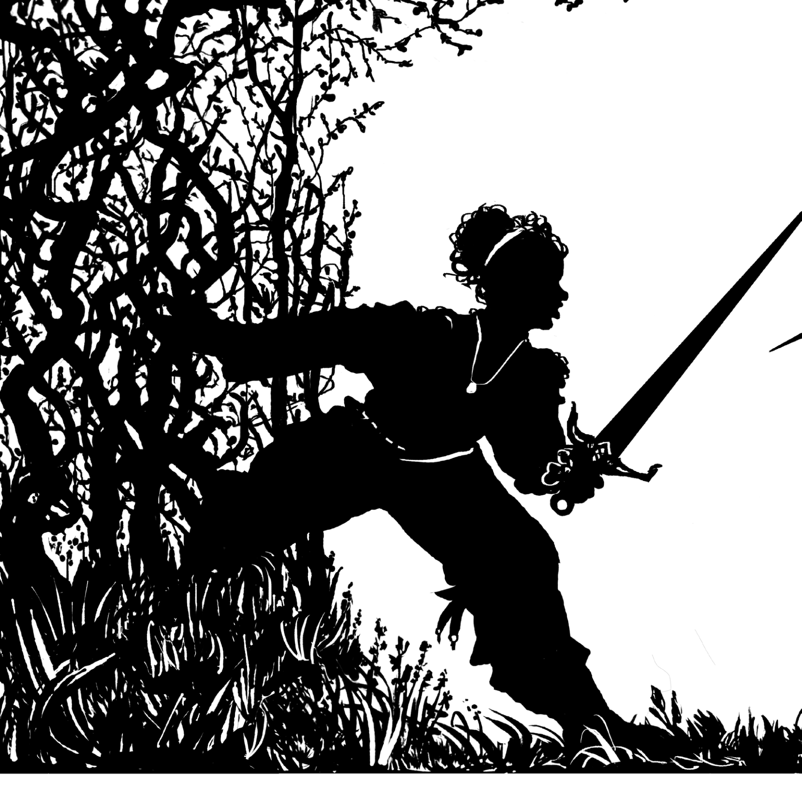

60
Section 3
Rules

---
## p.61

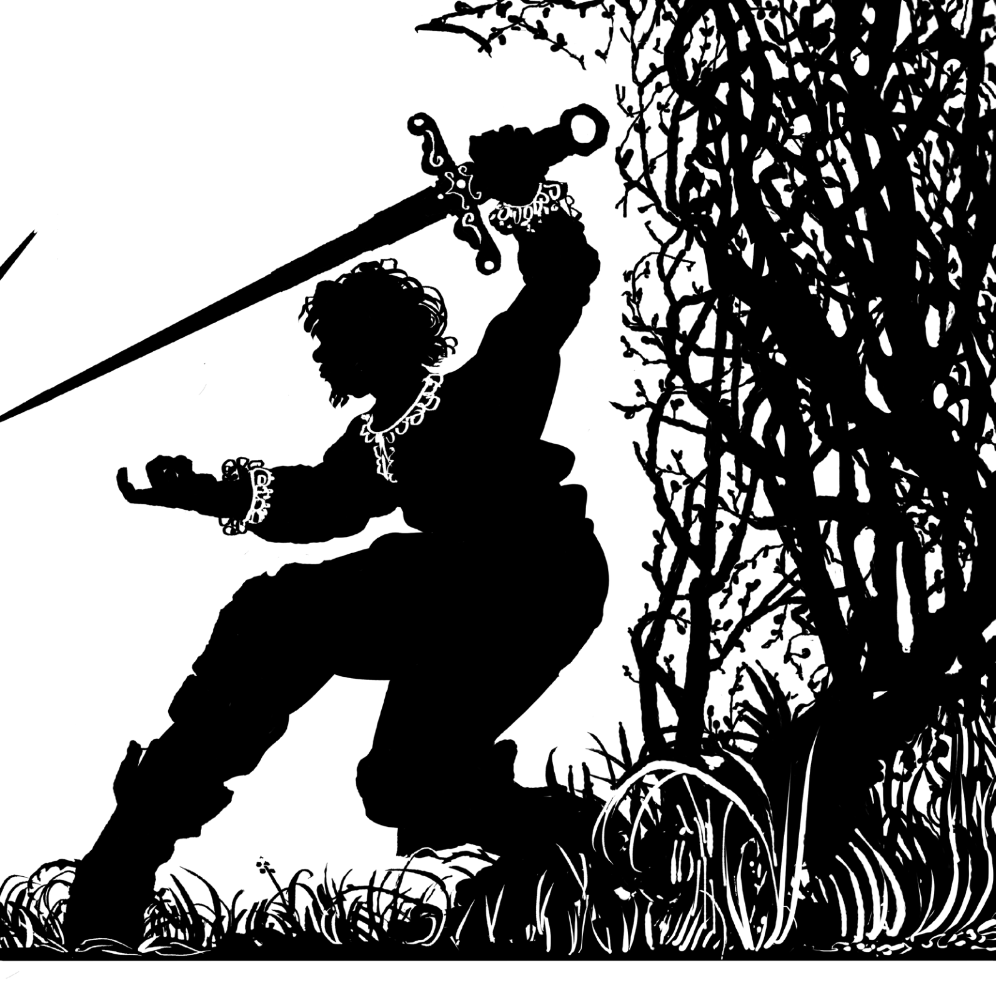

61

---
## p.62

62
Core Rules
Attributes
Each of the three attributes are used in different circumstances. (see Saves.)
Saves
-  A save is a roll to avoid negative outcomes from risky choices. Characters roll 
a d20 and compare the results to the appropriate attribute. If they roll equal 
to or under that attribute, they succeed. Otherwise, they fail. A 1 is always a 
success, and a 20 is always a failure.
-  If two opponents are each trying to overcome the other, whoever is most at 
risk should save.
-  If two characters need to take an action together, whoever is most at risk 
should save (usually the character with the lowest relevant Attribute).
Healing & Recovery
-  Resting for a few moments and having a drink of water restores lost HP but 
may leave the party exposed. Bandages can stabilize a character that has taken 
Critical Damage.
-  Attribute loss (see Critical Damage) can usually be restored with a week’s rest, 
facilitated by a healer or other appropriate source of expertise.
-  Some healing services are free, while magical or more expedient means of 
recovery may come at a cost.
Deprivation & Fatigue
-  A PC that lacks a crucial need (such as food or rest) is Deprived. Anyone 
Deprived for more than a day adds Fatigue to their inventory, one for each 
day. A Deprived PC cannot recover HP, Attributes, or item slots from Fatigue.
-  A PC may also be forced to add Fatigue after casting spells or due to events 
occurring in the fiction. Each Fatigue occupies one slot and lasts until the PC 
is able to recuperate (such as with a full night’s rest in a safe spot).
-  If a character is forced to add Fatigue to their inventory but they have no free 
slots, they must drop an item from their inventory.
Strength (STR)
Used for saves requiring 
physical power, like 
lifting gates, bending 
bars, resisting poison, 
etc.
Dexterity (DEX)
Used for saves requiring 
poise, speed, reflexes, 
dodging, climbing, 
sneaking, balancing, etc.
Willpower (WIL)
Used for saves to 
persuade, deceive, 
interrogate, intimidate, 
charm, provoke, 
manipulate spells, etc.

---
## p.63

63
Reactions
2
3-5
6-8
9-11
12
Hostile
Wary
Curious
Kind
Helpful
Armor
-  Before calculating damage to HP, subtract the target’s Armor value from the 
result of damage rolls.
-  Shields and similar armor provide a bonus defense (e.g. +1 Armor), but only 
while the item is held or worn. Some may also provide additional benefits, 
depending on the fiction.
-  A PC, NPC, or monster cannot have more than 3 Armor.
Reactions
When the PCs encounter an NPC whose reaction to the party is not obvious, 
the Warden may roll 2d6 and consult the following table:
Morale
-  Enemies must pass a WIL save to avoid fleeing when they take their first 
casualty and again when they lose half their number.
-  Some groups may use their leader’s WIL in place of their own. Lone foes must 
save when they’re reduced to 0 HP.
-  Morale does not affect PCs.
Hirelings
-  Adventuring parties can recruit hirelings, relying on their unique skills, 
knowledge, and training to aid in expeditions.
-  To create a hireling, choose an appropriate role from the Hirelings table in 
the Marketplace (pg. 16). Roll 3d6 for each attribute and 1d6 for their HP. Give 
them equipment appropriate to their station, then roll on the Character Traits 
tables to further flesh them out.
-  Alternatively, choose an appropriate background and name from the 
Character Creation guide. Roll (or choose from) the tables for that 
background. Then roll for Rations, Gold Pieces, Attributes, HP, and age.
Die of Fate
-  Optionally, roll 1d6 whenever the outcome of an event is uncertain or to 
simulate an element of randomness and chance.
-  A roll of 4 or more generally favors the PCs, while a roll of 3 or under usually 
means bad luck for the PCs.

---
## p.64

64
Combat
Rounds
-  A round is roughly ten seconds of in-game time and proceeds with each side 
taking turns. Each round starts with all PCs that are able to act, followed by 
their opponents. The result of each side’s actions occur simultaneously.
-  During the first round of combat, each PC must make a DEX save in order 
to act. Special circumstances, abilities, items, or skills may negate this 
requirement. PCs that fail their save lose their turn for this round.
-  Their opponents then take their turn, and the first round ends. The next 
round begins with the PCs taking their turn, followed by their opponents, and 
so on until combat has ended with one side defeated or fled.
Actions
-  On their turn, a character may move up to 40ft and take up to one action. This 
may be casting a spell, attacking, moving for a second time, or some other 
reasonable action. Each round, the PCs declare what they are doing before 
dice are rolled. If a character attempts something risky, the Warden calls for a 
save for appropriate players or NPCs.
Attacking & Damage
-  The attacker rolls their weapon die and subtracts the target’s armor, 
then deals the remaining total to their opponent’s HP. Attacks in combat 
automatically hit.
-  If multiple attackers target the same foe, roll all damage dice and keep the 
single highest result. All actions are declared before being resolved.
-  If an attack would take a PC’s HP exactly to 0, refer to the Scars table (pg. 66) 
to see how they are uniquely impacted.
Attack Modifiers
-  If fighting from a position of weakness (such as through cover or with 
bound hands), the attack is Impaired, and the attacker must roll 1d4 damage 
regardless of the attack’s damage die. Unarmed attacks always do 1d4 damage.
-  If fighting from a position of advantage (such as against a helpless foe or 
through a daring maneuver), the attack is Enhanced, allowing the attacker to 
roll 1d12 damage instead of their normal die.
-  Attacks with the Blast quality affect all targets in the noted area, rolling 
separately for each affected character. This can be anything from explosions 
to a dragon’s breath or the impact of a meteorite. If unsure how many targets 
can be affected, roll the related damage die for a result.
-  If attacking with two weapons at the same time, roll both damage dice and 
keep the single highest result (denoted with a plus symbol, e.g. d8+d8).

---
## p.65

65
Critical Damage
-  Damage that reduces a target’s HP below zero is subtracted from their STR 
by the amount of damage remaining. The target must then immediately make 
a STR save to avoid taking Critical Damage, using their new STR score. On a 
success, the target is still in the fight (albeit with a lower STR score) and must 
continue to make Critical Damage saves when incurring damage.
-  Any PC that suffers Critical Damage cannot do anything but crawl weakly, 
grasping for life. If given aid (such as bandages), they will stabilize. If left 
untreated, they die within the hour. NPCs and monsters that fail a Critical 
Damage save are considered dead, per the Warden’s discretion. Additionally, 
some enemies will have special abilities or effects that are triggered when 
their target fails a Critical Damage save.
Attribute Loss
-  If a PC’s STR is reduced to 0, they die. If their DEX is reduced to 0, they are 
paralyzed. If their WIL is reduced to 0, they are delirious. Complete DEX and 
WIL loss renders the character unable to act until they are restored through 
extended rest or by extraordinary means.
-  If a PC takes damage outside of combat, they should instead receive damage 
to an Attribute, typically STR.
Character Death
-  When a character dies, the player should create a new character or take 
control of a hireling. They immediately join the party in order to reduce 
downtime.
Detachments
-  Large groups of similar combatants fighting together are treated as a single 
Detachment. When a detachment takes Critical Damage, it is routed or 
significantly weakened. When it reaches 0 STR, it is destroyed.
-  Attacks against detachments by individuals are Impaired (excluding Blast 
damage). 
-  Attacks against individuals by detachments are Enhanced and deal Blast 
damage.
Retreat
-  Running away from a dire situation always requires a successful DEX save, as 
well as a safe destination to run to.
Ranged Attacks
-  Ranged weapons can target any enemy near enough to see the whites of their 
eyes. Attacks against especially distant targets are Impaired.
-  Ammunition is not tracked unless otherwise specified.

---
## p.66

66
Scars
If damage to a PC would reduce their HP to exactly 0, look up the result on the 
table below based on the amount of HP lost in the attack. For example, if a PC 
went from 3 HP to 0 HP, they would look at entry #3 (Walloped).
How much HP did you lose?
1 HP
Lasting Scar: Roll 1d6 | 1: Neck, 2: Hands, 3: Eye, 4: Chest, 5: Legs, 6: Ear. 
Roll 1d6. If the total is higher than your max HP, take the new result.
2 HP
Rattling Blow: You’re disoriented and shaken. Describe how you refocus. 
Roll 1d6. If the total is higher than your max HP, take the new result.
3 HP
Walloped: You’re sent flying and land flat on your face, winded. You are 
deprived until you rest for a few hours. Then, roll 1d6. Add that amount to 
your max HP.
4 HP
Broken Limb: Roll 1d6 | 1-2: Leg, 3-4: Arm, 5: Rib, 6: Skull. Once mended, 
roll 2d6. If the total is higher than your max HP, take the new result.
5 HP
Diseased: You’re afflicted with a gross, uncomfortable infection. When 
you get over it, roll 2d6. If the total is higher than your max HP, take the 
new result.
6 HP
Reorienting Head Wound: Roll 1d6 | 1-2: STR, 3-4: DEX, 5-6: WIL. Roll 3d6. 
If the total is higher than your current attribute, take the new result.
7 HP
Hamstrung: You can barely move until you get serious help and rest. After 
recovery, roll 3d6. If the total is higher than your max DEX, take the new 
result.
8 HP
Deafened: You cannot hear anything until you find extraordinary aid. 
Regardless, make a WIL save. If you pass, increase your max WIL by 1d4.
9 HP
Re-brained: Some hidden part of your psyche is knocked loose. Roll 3d6. 
If the total is higher than your max WIL, take the new result.
10 HP
Sundered: An appendage is torn off, crippled, or useless (the Warden will 
tell you which.) Then make a WIL save. If you pass, increase your max WIL 
by 1d6.
11 HP
Mortal Wound: You are deprived and out of action. You die in one hour 
unless healed. Upon recovery, roll 2d6. Take the new result as your max 
HP.
12 HP
Doomed: Death seemed ever so close, but somehow you survived. If your 
next save against Critical Damage is a fail, you die horribly. If you pass, roll 
3d6. If the total is higher than your max HP, take the new result.

---
## p.67

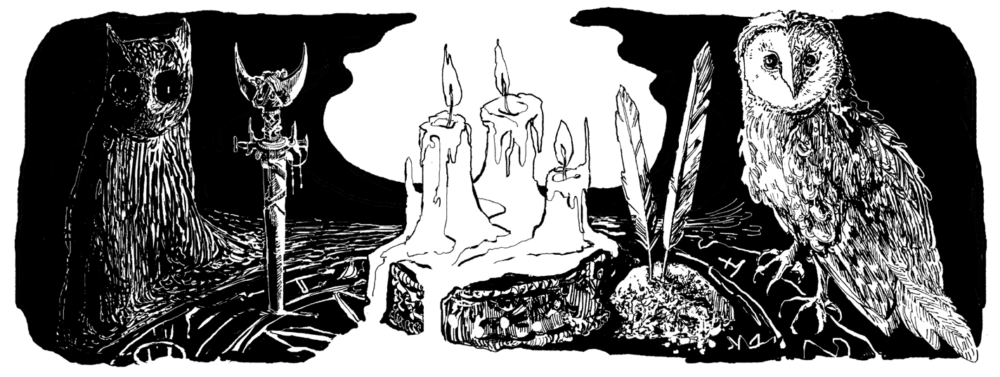

67
Magic
Spellbooks
-  Spellbooks contain a single spell and take up one slot. They cannot be easily 
transcribed or created; instead they are recovered from places like tombs, 
dungeons, and manors.
-  Spellbooks sometimes display unusual properties or limitations, such as 
producing a foul or unearthly smell when opened, possessing an innate 
intelligence, or being legible only when held in moonlight.
-  Spellbooks will attract the attention of those who seek the arcane power 
within, and it is considered dangerous to display them openly.
Casting Spells
-  Anyone can cast a spell by holding a Spellbook in both hands and reading its 
contents aloud. They must then add a Fatigue to inventory.
-  Given time and safety, PCs can enhance a spell’s impact (e.g., affecting multiple 
targets, increasing its power, etc.) without any additional cost.
-  If the PC is deprived or in danger (such as during combat), the Warden may 
require a PC to make a WIL save to avoid any ill-effects from casting the spell. 
Consequences of failure are on par with the intended effect and may result in 
added Fatigue, the destruction of the Spellbook, injury, and even death.
Scrolls
Scrolls are similar to Spellbooks, however:
-  They are petty.
-  They do not cause Fatigue.
-  They disappear after one use.
Relics
-  Relics are items imbued with a magical spell or power. They do not cause 
Fatigue. Relics usually have limited uses, as well as a Recharge condition.

---
## p.68

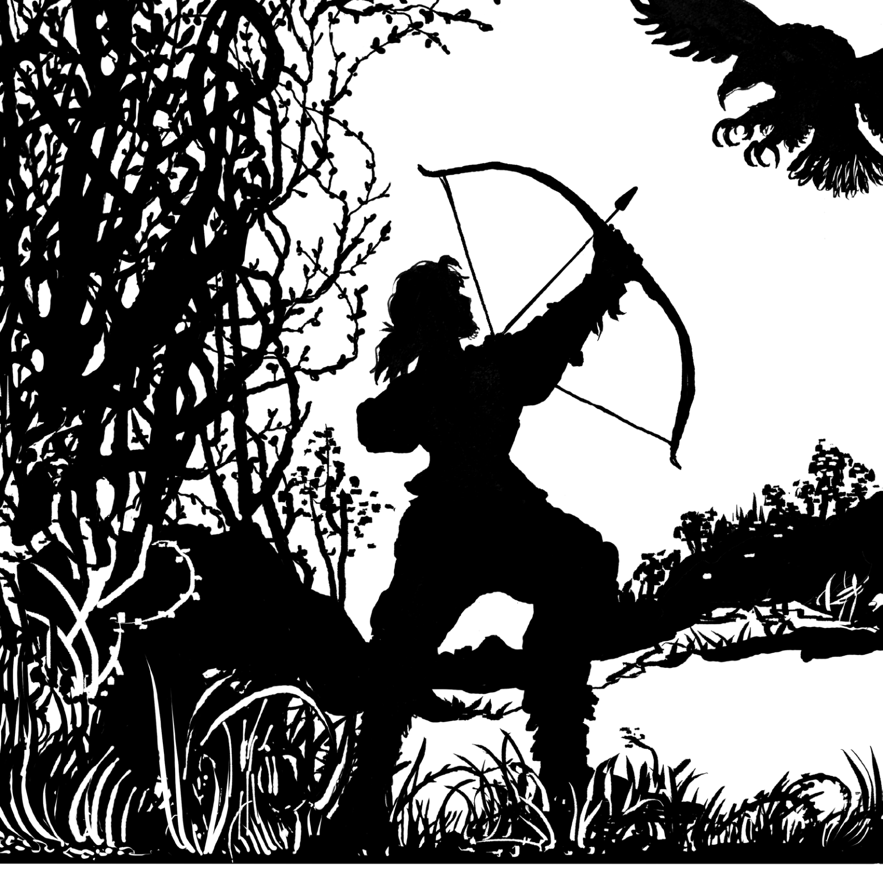

68
Section 4
Procedures

---
## p.69

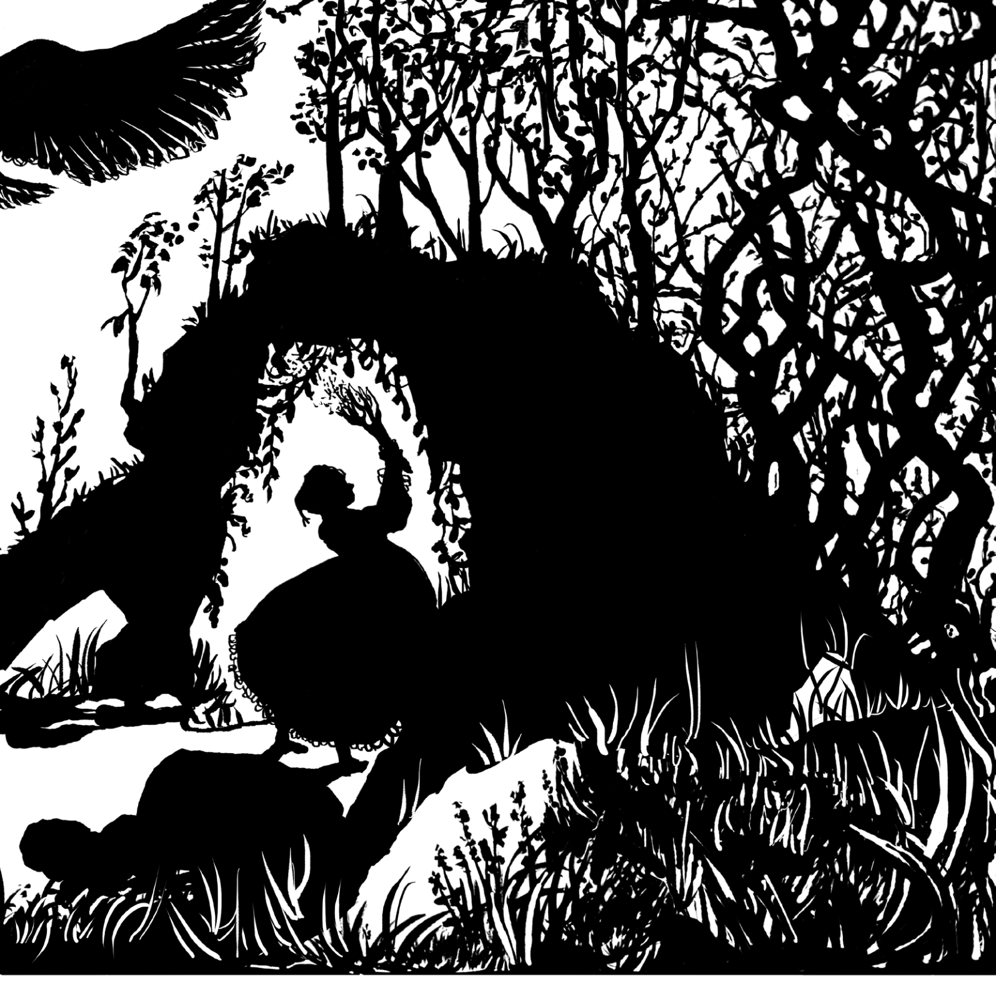

69

---
## p.70

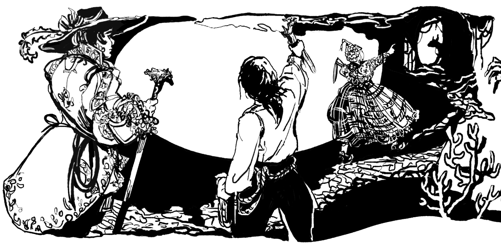

70
Dungeon Exploration
The Basics
-  The dungeon exploration cycle (see below) is divided into a series of Turns, 
Actions, and their consequences.
-  On their Turn, a character can move a distance equal to their torchlight’s 
perimeter (about 40ft) and perform one Action. Players can use their action to 
move up to three times that distance, though that will increase the chance of 
triggering a roll on the Dungeon Events table.
-  The Warden should present obvious information about an area and its 
dangers freely and at no cost. Moving quickly or without caution may increase 
the chance of encountering a wandering monster, springing a trap, or 
triggering a roll on the Dungeon Events table.
Although the term “dungeon” is used here, it can mean any dangerous locale (mansions, 
farmhouses, adventure site, etc.).
Dungeon Exploration Cycle
1.  The Warden describes the party’s surroundings and any immediate dangers 
(combat, traps, surprises, etc.). The players then declare their character’s 
intended movements and Actions.
2.  The Warden resolves the actions of each character simultaneously, along 
with any actions that are already in progress. Remember, the Die of Fate can 
be a useful tool whenever the Warden is in doubt!
3.  The players record any loss of resources and any new conditions (i.e. item 
use, deprivation, etc). The cycle then begins again. If appropriate, the 
Warden should roll on the Dungeon Events table. Keep common sense in 
mind when interpreting the results!

---
## p.71

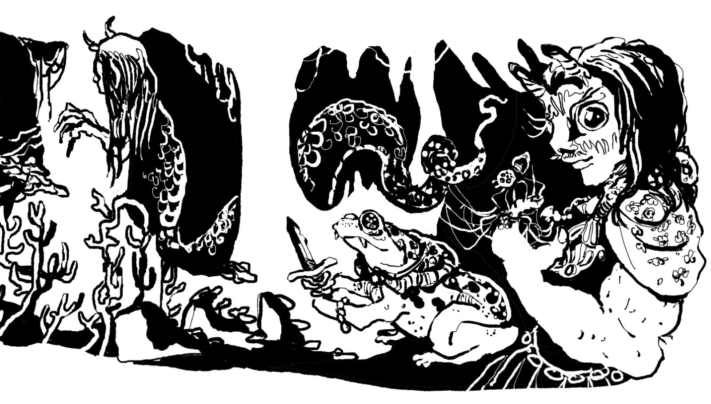

71
d6
Dungeon Events
1
Encounter
Roll on an encounter table. Possibly hostile. (See Reactions 
(pg. 63).)
2
Sign
A clue, spoor, track, abandoned lair, scent, victim, etc is 
discovered.
3
Environment
Surroundings shift or escalate. Water rises, ceilings collapse, 
a ritual nears completion, etc.
4
Loss
Torches are blown out, an ongoing spell fizzles, etc. The party 
must resolve the effects before moving on.
5
Exhaustion
The party must take a brief rest (roll on this table again), add 
a Fatigue, or consume a ration.
6
Quiet
The party is left alone (and safe) for the time being.
Dungeon Events
Exploring a dungeon is always dangerous, and time must always be weighed 
against the risk of awakening the location’s denizens, natural hazards, and worse.
When the party:
-  Spends more than one dungeon cycle in a single room or location.
-  Moves quickly or haphazardly through a room.
-  Moves into a new area, level, or zone.
-  Creates a loud disturbance.
Roll on the table below:

---
## p.72

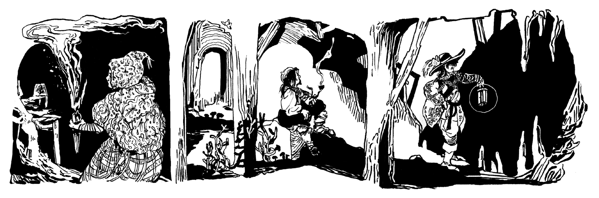

72
Actions
-  Actions are any non-passive activities, such as searching for traps, forcing 
open a door, listening for danger, disarming a trap, engaging an enemy in 
combat, casting a spell, dodging a trap, running away, resting, etc.
-  Some actions have special rules (see below), while others may take multiple 
turns to complete.
-  Loud or noticeable actions may also trigger an encounter with the dungeon’s 
denizens.
Searching
-  A character can spend a turn performing an exhaustive search of one object or 
location in an area, revealing any relevant hidden treasure, traps, secret doors, 
etc.
-  Larger rooms and difficult or complex dungeon terrain may take a few turns 
to properly search.
-  Searching a room first is a safer way to explore the dungeon, but it has a steep 
cost: time.
Resting
-  A character can spend a turn resting to restore all HP.
-  A light source and a safe location are required to rest. Present or oncoming 
danger makes rest impossible.
-  Resting does not restore Fatigue, as it is impossible to safely Make Camp (pg. 
79) in a dungeon.
Panic
-  A character that is surrounded by enemies, enveloped by darkness, or facing 
their greatest fears may experience panic. A WIL save is typically required to 
avoid losing control and becoming panicked.
-  A panicked character must make a WIL save to overcome their condition as an 
action on their turn.
-  A panicked character has 0 HP, does not act in the first round of combat, and 
all of their attacks are impaired.

---
## p.73

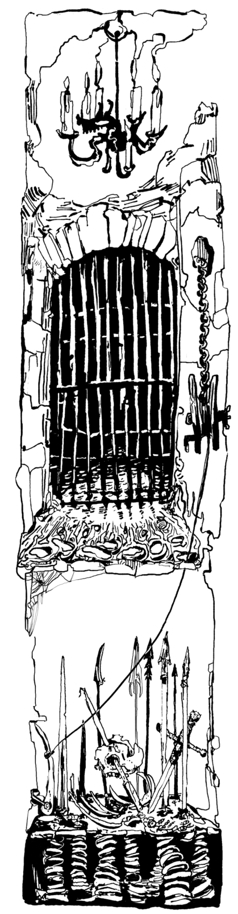

73
Dungeon Elements
Light
-  Torches and other radial sources of light 
illuminate 40ft of dungeon and beyond that 
only a dim outline of objects. Torches last 
until they are put out by a character or their 
environment.
-  A torch can be lit 3 times before 
permanently degrading. A lantern can be 
relit indefinitely but requires an Oil Can (6 
uses).
-  Characters without a light source may suffer 
from panic until their situation is remedied.
Doors
-  Doors and entryways may be locked, stuck, 
or blocked entirely. Characters can try to 
force a door open (or wedge it shut) using 
available resources (spikes, glue) or through 
raw ability.
-  The party’s marching order determines who 
is most impacted by whatever lies beyond a 
door.
-  A character can detect, through careful 
observation (listening, smelling, etc.), signs 
of life and other hazards through nearby 
doors and walls.
Traps
-  A cautious character should be presented 
with any and all information that would 
allow them the opportunity to avoid 
springing a trap. An unwitting character will 
trigger a trap according to the fiction, or will 
otherwise have a 2-in-6 chance.
-  Traps can usually be detected by carefully 
searching a room.
-  Damage from traps is taken from attributes 
(usually STR or DEX) and not from HP. 
Armor can reduce damage, but only if 
applicable (e.g. a shield would not reduce 
damage from noxious gas).

---
## p.74

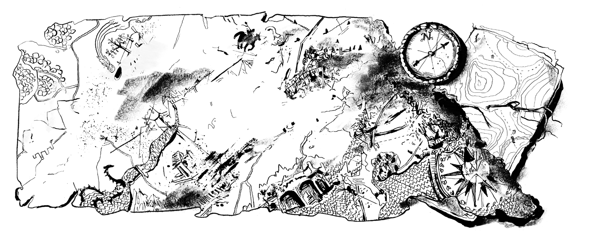

74
Wilderness Exploration
Watches
-  A day is divided into three watches: morning, afternoon, and night.
-  Each character can choose one Wilderness Action (pg. 79) per watch.
-  If the characters split up, each group is treated as an independent entity.
Points
-  Potential destinations on a map are called points.
-  One or more watches may be required to journey between two points on a 
map, depending on the path, terrain, weather, and party status.
-  The party should have a rough idea of the challenges involved to get to their 
destination, but rarely any specifics.
Travel Duration
Travel time in Cairn is counted in watches, divided into three eight-hour 
segments per day. However, as most parties elect to spend the third watch of the 
day resting, one can use “days” as a shorthand for travel time. For example, if the 
distance between two points is equal to four watches, the party would need to 
travel for two days, arriving in the evening of the second day.
To determine the distance between two points, combine all penalties from the 
path, terrain, and Weather Difficulty (pg. 76) tables, taking into account any 
changes to those elements along the route. For travel via waterways, refer to the 
surrounding terrain difficulty. For especially vast terrain, assign a penalty of up to 
+2 watches to the journey.
The weather, terrain, darkness, injured party members, and other obstacles can 
impact travel or even make it impossible! In some cases, the party may need to 
add Fatigue or expend resources in order to sustain their pace. Mounts, guides, 
and maps can increase the party’s travel speed or even negate certain penalties.

---
## p.75

75
Path Type
Path
Penalty
Odds of Getting Lost
Roads
None
None
Trails
+1 Watch
2-in-6
Wilderness
+2 Watches
3-in-6
Path Distance
Distance
Penalty
Short
+1 Watch
Medium
+2 Watches
Long
+3 Watches
Terrain Difficulty
Difficulty
Terrain
Penalty
Factors
Easy
Plains, plateaus, 
valleys
None
Safe areas for rest, fellow travelers, 
good visibility
Tough
Forests, deserts, 
hills
+1 Watch
Wild animals, flooding, broken 
equipment, falling rocks, unsafe 
shelters, hunter’s traps
Perilous
Mountains, jungles, 
swamps
+2 Watches
Quicksand, sucking mud, choking 
vines, unclean water, poisonous 
plants and animals, poor navigation

---
## p.76

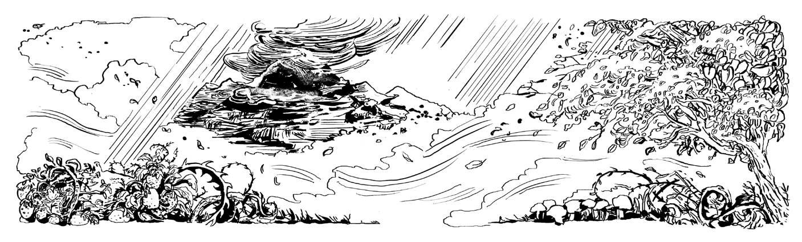

76
Weather
Each day, the Warden should roll on the weather table for the appropriate season. 
If the “Extreme” weather result is rolled twice in a row, the weather turns to 
“Catastrophic.” A squall becomes a hurricane, a storm floods the valley, etc.
Weather Difficulty
Weather
Effect
Examples
Nice
Favorable conditions for travel.
Clear skies, sunny
Fair
Favorable conditions for travel.
Overcast, breezy
Unpleasant
Add a Fatigue or add +1 watch.
Gusting winds, rain showers, 
sweltering heat, chill air
Inclement
Add a Fatigue or add +1 watch. 
Increase terrain difficulty by a step.
Thunderstorms, lightning, 
rain, muddy ground
Extreme
Add a Fatigue and add +1 watch. 
Increase terrain difficulty by a step.
Blizzards, freezing winds, 
flooding, mud slides
Catastrophic
Most parties cannot travel under 
these conditions.
Tornados, tidal waves, 
hurricane, volcanic eruption
Weather
d6
Spring
Summer
Fall
Winter
1
Nice
Nice
Fair
Fair
2
Fair
Nice
Fair
Unpleasant
3
Fair
Fair
Unpleasant
Inclement
4
Unpleasant
Unpleasant
Inclement
Inclement
5
Inclement
Inclement
Inclement
Extreme
6
Extreme
Extreme
Extreme
Extreme

---
## p.77

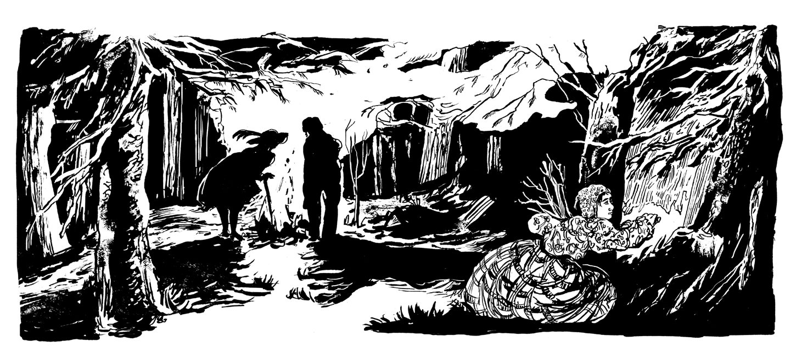

77
Wilderness Elements
Night
-  The party can choose to travel during the night and rest during the day, but 
night travel is far slower and more treacherous!
-  Traveling at night is always more dangerous! The Warden should roll twice on 
the Wilderness Events table.
-  Some terrain and weather may be easier to traverse at night (desert, for 
example). The Warden should balance these challenges along with any other.
Sleep
-  The last watch of the day is typically reserved for the Make Camp (pg. 79) 
action.
-  Characters typically need to sleep each day. Anything beyond a minor 
interruption can negate or cancel the benefits of sleep.
-  If the party skips the Make Camp (pg. 79) action, they each add a Fatigue to 
their inventory and are deprived. Additionally, traveling when sleep-deprived 
raises the terrain Difficulty by a step (i.e. Easy becomes Tough).
Light
-  Torches and other radial sources of light illuminate 40-ft ahead of the party 
but beyond that only provides a dim outline of objects.
-  Characters without a light source may suffer from panic until their situation is 
remedied.
-  Environmental conditions (sudden gusts of wind, dust, water, etc.) can easily 
blow out a torch.
Light Sources
-  A torch can be lit 3 times before degrading. 
-  A lantern can be relit indefinitely but requires a separate Oil Can (6 uses).

---
## p.78

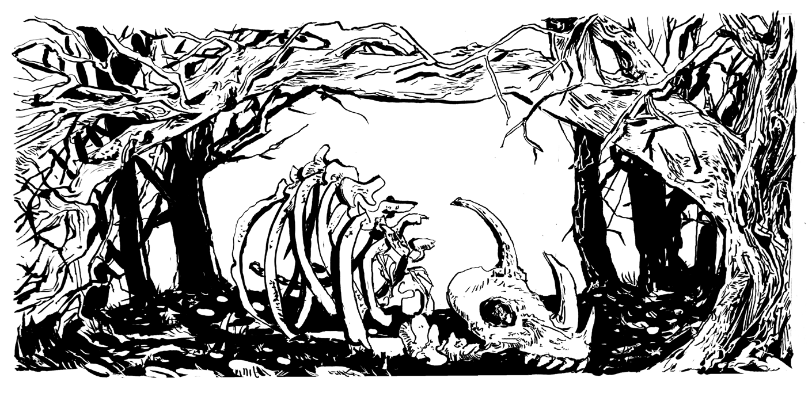

78
Wilderness Exploration Cycle
1.  The Warden describes the current point or region on the map and how the 
path, weather, terrain, or party status might affect travel speed. The party 
plots or adjusts a given course towards their destination.
2.  Each character chooses a single Wilderness Action (pg. 79). The Warden 
narrates the results and then rolls on the Wilderness Events table. The party 
responds to the results.
3.  The players and the Warden record any loss of resources and new conditions 
(i.e. torch use, deprivation, etc), and the cycle repeats.
d6
Wilderness Events
1
Encounter
Roll on an encounter table for that terrain type or location. 
Don’t forget to roll for NPC reactions if applicable.
2
Sign
The party discovers a clue, spoor, or indication of a nearby 
encounter, locality, hidden feature, or information about a 
nearby area.
3
Environment
A shift in weather or terrain.
4
Loss
The party is faced with a choice that costs them a resource 
(rations, tools, etc), time, or effort.
5
Exhaustion
The party encounters a barrier, forcing effort, care or delays. 
This might mean spending extra time (and an additional 
Wilderness Action) or adding Fatigue to the PC’s inventory 
to represent their difficulties.
6
Discovery
The party finds food, treasure, or other useful resources. 
The Warden can instead choose to reveal the primary 
feature of the area.

---
## p.79

79
Wilderness Actions
Travel
-  Travel begins. Obvious locations, features, and terrain of nearby areas are 
revealed according to their distance. This action is typically taken by the 
entire party as one.
-  The party rolls 1d6 to see if they get lost along the way. This risk can increase 
or decrease, depending on Path Difficulty (pg. 75), maps, party skills, and 
guides.
-  If lost, the party may need to spend a Wilderness Action to recover their way. 
Otherwise, the party reaches the next point along their route. 
Remember to compare the results of getting lost to the relevant Path Difficulty.
Explore
-  One or more party members search a large area, searching for hidden 
features, scouting ahead, or treading carefully.
-  A Location (shelter, village, cave, etc.) or Feature (geyser, underground river, 
beached ship, etc.) is discovered.
-  The Travel action is still required to leave the current area, even if it has been 
completely explored.
Supply
-  One or more party members may hunt, fish, or forage for food, collecting 
1d4 Rations (3 uses each). The chance of a greater bounty increases with 
each additional participant (e.g. 1d4 becomes 1d6, up to a maximum of 1d12). 
Relevant experience or equipment may also increase the bounty.
-  The party may encounter homes and small villages, spending gold and a full 
Watch (pg. 74) to resupply.
Make Camp
-  The party stops to set up camp in the wilds. Each party member (and their 
mounts) consumes a Ration.
-  A lookout rotation is set so that the party can sleep unmolested. A smaller 
party may need to risk sleeping unguarded or switch off sleeping over multiple 
days.
-  Party members that were able to rest remove all Fatigue from their inventory.

---
## p.80

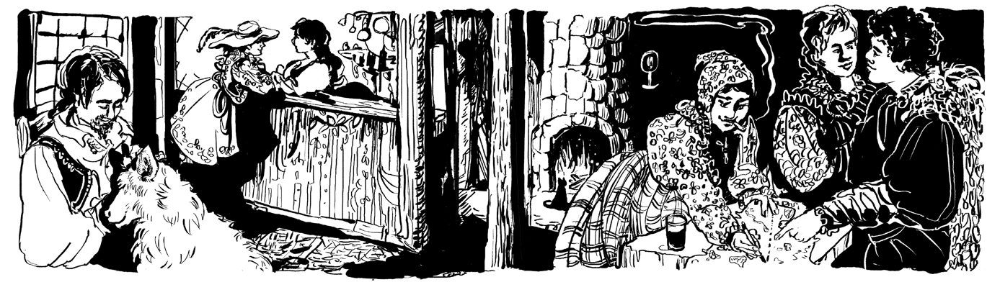

80
Downtime
Between game sessions, players can engage in a variety of activities such as 
research, following up on leads, improving skills, or building relationships. A PC is 
limited to one Downtime Action at a time. These actions cannot be undertaken in 
unsafe conditions or while a character is in recovery. A character cannot perform 
a downtime action if it would put their safety at risk.
Milestones
For activities requiring multiple steps, the Warden assigns 1-5 Milestones for 
players to track progress. Each Milestone represents a comprehensive, non-
interactive task. The Warden may present different strategies to achieve these 
goals, each with distinct Milestones. Depending on the unfolding events in the 
game, the Warden is also empowered to introduce new Milestones or discard 
existing ones.
Costs
PCs can complete individual Milestones by taking a Downtime Action and paying 
its respective Cost. If a character is unable to pay the Cost, they may have to find 
some other way to achieve their goal. A few examples of Cost:
-  Gold: Direct payment of gold from a character’s inventory.
-  Resources: Non-monetary costs, such as material goods, specific common 
items, and so on.
-  Reputation: Betting on a character’s renown, personality, presence, social 
connections, etc.
-  Loss: Offering something specific and unique. A finger, a soul, a Relic, etc.
Some Costs can be reduced or disregarded through character skills, connections, 
or force of will. For example, a PC may have already acquired the necessary 
reputation to gain access to a renowned institution, and thus the cost is abated. 
On the other hand, another character may not be so lucky and must rely on 
their force of personality instead. In this case, the Warden should state the risk 
(a permanent ban on entry, a loss of reputation, etc.). The PC then makes a WIL 
save; on a success, the cost is either reduced or avoided entirely.

---
## p.81

81
Downtime Actions
The following activities represent some of the most common Downtime Actions 
a players can choose. The Warden can also create custom actions based on the 
needs of play.
Research
A PC investigates a single question about a bit of lost or forgotten lore, the location 
of a lost item, the whereabouts of an important NPC, and so on. To take this 
action, the player must have a clearly formulated question they’d like to answer 
and a Source of knowledge in the game world that their character can interact 
with. If the PC does not have a Source, then they can spend a Downtime Action 
trying to find one. There is no guarantee that they will be successful. Once a 
question is posed and an appropriate Source has been identified, the Warden 
should provide any Milestones and associated Costs.
Questions
As always, the question must come from an experience that occurred during play. 
Examples:
-  “Where is the Lost Temple of East Nipoor?”
-  “Who in Fortune City might know how to crack an ancient vault?”
-  “Where can I find the cure to curly sickness?”
Sources
A Source is a person, place, faction, or entity that holds either a part or whole 
answer that the character seeks. They can be NPCs, Factions, spirits, or even 
other PCs. 
Examples:
-  Kewr the Mouth, a frequent contact for the Conclave of Merchants. Despite 
their excellent relationship with this faction, asking for help in an illicit 
activity might come at a high cost.
-  A Woodwose who makes his home deep in the Forest of Knives. The party 
encountered him in an earlier expedition, and the encounter did not end 
well. Still, he is said to know the nature of every herb and their healing 
properties.
-  The Temple of Puppets, a nomadic circus troupe who have travelled the 
known and unknown lands. The party assisted one of their members during 
the Rain of Fire, when even the creatures of the Wood were preparing to 
flee their homes. If anyone has heard of forgotten places, it’s them.

---
## p.82

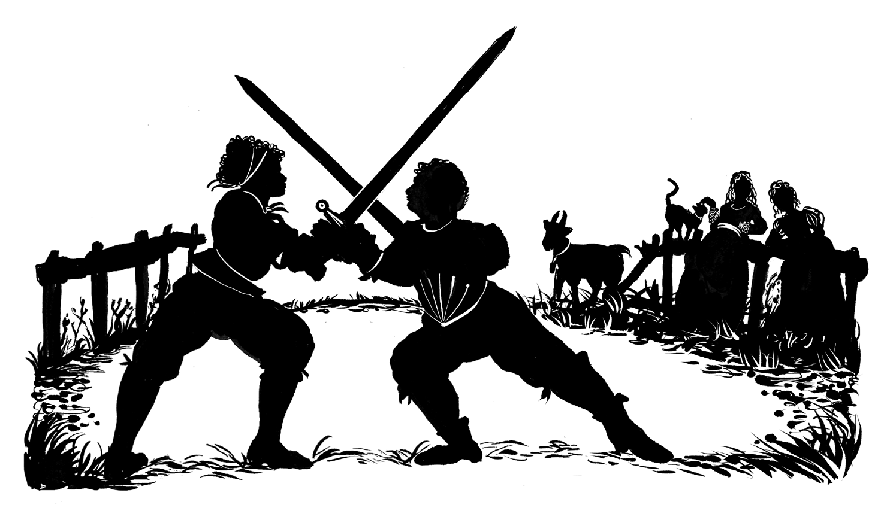

82
Training
A character can improve their skills with an item or ability, with clear narrative 
or mechanical results. They might be interested in dealing greater damage with 
a particular weapon, decreasing their chances of getting lost in rough weather, 
or learning to read the languages of the ancients. A PC might spend multiple 
Downtime Actions sparring with a particular weapon, improving their skills week 
by week. Or they may need to travel to the home of a distant sage, improving 
themselves through short but intense study.
The player must describe precisely what they’d like to improve and a Master 
whom they might train with. And of course, the character’s inspiration to improve 
should come from an experience in play. The Warden should provide any 
Milestones and associated Costs.
Examples:
-  The Two-Handed Parry: When fighting with one hand free, a PC’s HP 
temporarily increases by 1d4. The party took on a hireling from the Cratered 
Lands, whose fighters emphasize avoiding enemy attacks. She has agreed to 
train anyone who can best her in hand to hand combat.
-  Herbology: Given proper ingredients, a PC can create a Healing Salve 
(restores 1d4 STR, 1 use) as a Downtime Action. After receiving care from an 
elderly herbalist in the Verdant Glades, the wounded PC asked to be trained 
in the healing arts. The Master has agreed, but asked that they collect three 
rare herbs before training can begin.
-  Troutmaster: When taking the Supply Action, Rations gathered near cold 
freshwater sources increase by one step (e.g. 1d4 becomes 1d6). The party 
escorted a stranded naturalist from the famously dreadful Silver Wastes 
safely back to the city. As thanks, she has offered to train a PC to identify and 
capture a common lakefish that frequents colder waters.

---
## p.83

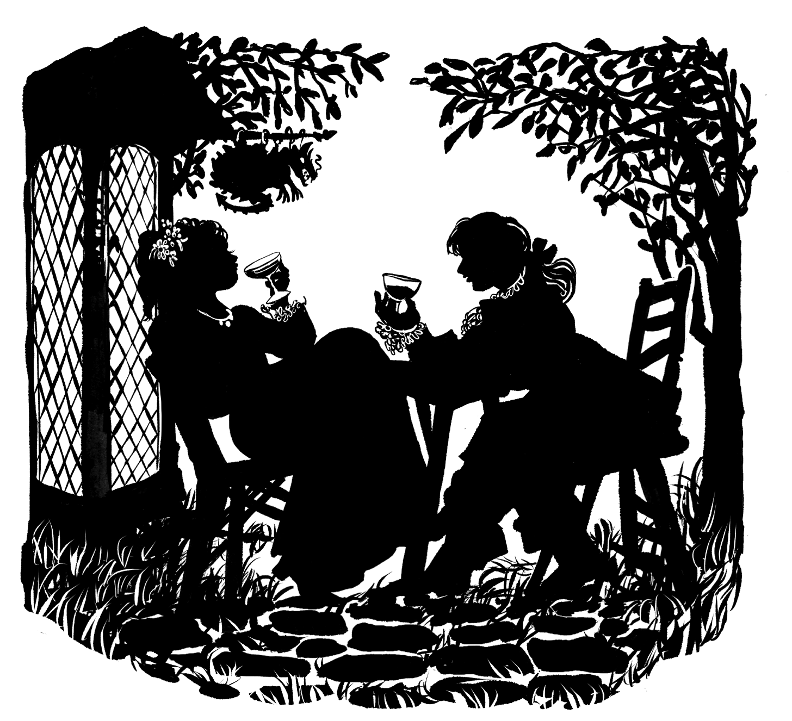

83
Strengthening Ties
A character fosters a connection with an NPC or Faction in the game world. First, 
they must identify the entity with whom they wish to strengthen ties, as well as 
a specific intent (e.g., building trust, mending a friendship, seeking membership 
in a Faction, forming an alliance, and so on). The Warden then provides concrete 
measures (described as Milestones and Costs) that the PC can undertake to 
advance the relationship. With each completed Milestone, the Warden describes 
how the PC’s relationship has grown or changed.
Examples:
-  After returning from an unsuccessful delve into the Roots, a PC discovers 
that they’d unknowingly brought along a stowaway: an eyeless devourer, 
barely hatched. They decide to keep the creature and train it in secret.
-  During a play session, a PC becomes friendly with an Agent of the Order 
of the Helm. Impressed by the Order’s values, the PC asks what the 
requirements are to join.
-  An agent for a powerful faction dies during the Battle of Frogs while under 
the party’s care. The party wishes to provide redress, so that the party can 
once again perform tasks for that faction.

---
## p.84

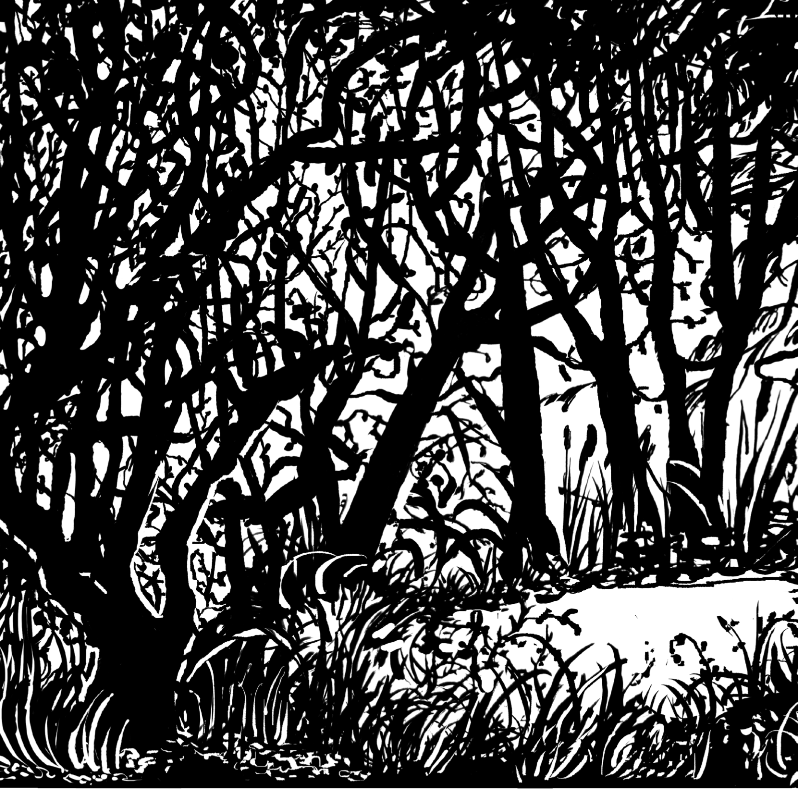

84
Section 5
The Setting of Vald

---
## p.85

85

---
## p.86

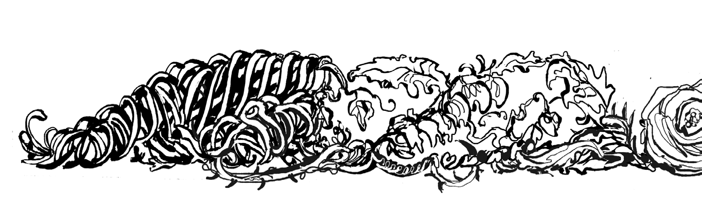

86
Vald
Introduction
The implied setting of Cairn is called Vald, encompassing all developed or 
settled lands, cities, towns, forests, etc. The specific ruler is irrelevant, as most 
adventures will take place in smaller towns and villages, the forest, and the 
margins of the realm. Most inhabitants (regardless of region) refer to the local 
centers of power as the Cities, occasionally as a pejorative.
Towns and villages are built near water and lumber sources, within a day’s walk 
of each other. Larger villages may rely on nearby farms and hunters. Settlements 
are often organized around specific industries like lumber, brewing, fishing, or 
mining, with a Fieldwarden or Beast Handler protecting their most valued assets.
Established trails between larger towns are fairly common, while maintained 
roads are almost non-existent except to the distant cities. Itinerant merchants, 
Kettlewrights, and various peddlers pass through settlements on a semi-regular 
basis, sometimes hiring Outriders to protect and escort larger caravans, or Rill 
Runners to help ferry passengers in the Riverlands.
Even the smallest village may play host to scholarly types from the cities: a 
Scrivener, Aurifex, or Greenwise with keen interest in nearby tombs, barrows, 
and Gates. Often a Bonekeeper or Fungal Forager will be hired for their expertise, 
while clever adventurers will ensure that a Barber-Surgeon is never far away, 
or a Cutpurse if there is unsavory business that needs tending to. Of course, 
Mountebanks and Jongleurs often accompany these sorts, riding their coattails in 
hopes that they too will benefit from the next major discovery.
Those who enter the Wood hire a guide familiar with the territory, such as a 
Prowler or Fletchwind, while the truly determined traveler will seek the wisdom 
of a Half Witch or Foundling with some connection to its darker secrets. Closer 
to the border, the Marchguard work to keep the realm free of outside influence, 
while the Hexenbane seek to protect it from forces within.

---
## p.87

87
The Wood
The Wood surrounds and divides the realm, representing not just one forest, but 
all forests. Denizens of the Wood are fiercely independent, believing they are 
subject solely to its rules. Its various peoples, creatures, and unrelenting natural 
elements have kept the outside world at bay since time immemorial.
At the core of each forest is a Heart Tree, the place where the forest is at its most 
powerful as well as its most dangerous. Each Heart Tree is born from a single 
Heartseed, acquired exclusively from a Heart Tree that is dying or dead.
The Wood is populated by creatures strange and wondrous, such as Goblins, 
Spirits, Treants, Trolls, Werewolves, Witches, and even talking plants and animals. 
Most are openly hostile to outsiders (particularly humans), but others will (on 
occasion) parley with those that have shown respect for the Wood. Of course, 
all demonstrate utter respect for the Fae (sometimes called the Pale Folk, or the 
Neighbors).
Of course, the Wood is not empty of people. Those who can survive (or even 
thrive) in such places learn to live according to the rules of the forest, for those 
who ignore or foolishly oppose these rules often meet grisly ends.
The Roots
The Roots is a realm of mystery and horror underground, where vast caves 
loom as large as an emptied ocean, without even a hint of sunlight. The various 
creatures and wild animals that survive there have developed natural means to 
live in the utter darkness, adapting their eyesight to function in even the dimmest 
light or eschewing vision altogether.
Entrances to the Roots, known as Gates, are scattered across the lands and are 
usually hidden or protected by powerful forces. Once opened, Gates permit 
dangerous creatures to pass through, giving them free reign over the weak and 
vulnerable.
Only the brave and foolish enter the Roots, and most do not return. The few that 
do whisper of the indescribable horrors and evil intelligence guarding these lost 
treasures. Still, there will always be those who cannot resist the draw of forgotten 
Relics, profound wealth, or knowledge, for there are rumors that creatures far 
more interesting than wild beasts make their home in the depths below.
Read more about Vald in the Warden’s Guide.

---
## p.88

