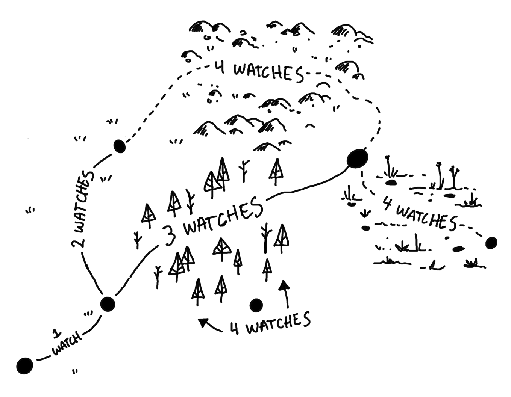

# Cairn 2e — 룰 요약

> 원본: `rule/Cairn_2e_Players_Guide.pdf` (88쪽, v1.0.0 · 2026-04, Text CC BY-SA 4.0)
> 전문: [src/rule_players_guide.md](src/rule_players_guide.md) — 배경 20종 표 · 마켓 가격 · 본드/오멘 d20 표는 여기서 찾는다 (`## p.N` 쪽 번호 그대로).
> 그림: [images/rule/](images/rule/) — `pNNN.png` = 그 쪽 그림. 배경 20종 삽화는 p020~p058 짝수 쪽.

## 설계 원칙
- **중립**: 워든(GM)은 중립 판정자.
- **클래스 없음**: 장비 · 경험이 곧 특기.
- **죽음**: 늘 가까이, 그러나 무작위 · 무경고 죽음은 없다.
- **픽션 우선**: 주사위보다 세계 속 요소로 성패 판정.
- **성장**: 레벨 없음. 위험을 살아남아 세계 안에서 성장.
- **플레이어 선택**: 위험 정보는 넉넉히 · 자주 준다.

## 캐릭터 생성 (p.8–17)
1. 배경 d20 (20종) → 이름 고르기, 시작 장비, 배경 표 d6 두 개 굴림.
2. 능력치 **STR · DEX · WIL** 각 3d6 순서대로, 두 개 맞바꾸기 허용.
3. **HP(Hit Protection) 1d6** — 체력이 아니라 피하는 능력. 금방 회복.
4. 외모 특성 d10 × 8 (체격 · 피부 · 머리 · 얼굴 · 옷 · 미덕 · 악덕 · 말투), **본드 d20**.
5. 나이 2d20+10. 가장 어린 PC 가 **오멘 d20** 굴려 낭독.

### 인벤토리
- 10칸. 편히 드는 건 4칸, **배낭** 기본 지급(+6칸, 아이템 또는 피로).
- petty = 0칸, bulky = 2칸. 100gp 미만 동전 = petty.
- **10칸 가득 = HP 0.** 10칸 넘게는 못 든다.

### 배경 20종 (d20)
1 Aurifex(연금술) · 2 Barber-Surgeon(이발외과의) · 3 Beast Handler(짐승 조련) · 4 Bonekeeper(장의사) · 5 Cutpurse(소매치기) · 6 Fieldwarden(밭지기) · 7 Fletchwind(궁수) · 8 Foundling(주워진 아이) · 9 Fungal Forager(버섯 채집) · 10 Greenwise(숲 학자) · 11 Half Witch · 12 Hexenbane(마녀 사냥) · 13 Jongleur(광대) · 14 Kettlewright(땜장이) · 15 Marchguard(국경 경비) · 16 Mountebank(약장수) · 17 Outrider(호위 기수) · 18 Prowler(숲 안내) · 19 Rill Runner(뱃사공) · 20 Scrivener(서기 학자)

공통 시작: 3d6 gp · 식량(3회) · 광원(횃불 3회 또는 랜턴+기름) + 배경 고유 무기 · 도구.

## 핵심 규칙 (p.62–67)

### 세이브
- d20 ≤ 능력치 → 성공. **1 은 늘 성공, 20 은 늘 실패.**
- 맞대결 · 공동 행동은 가장 위험한 쪽(보통 낮은 능력치)이 굴린다.
- STR: 힘 · 독 저항 / DEX: 반사 · 회피 · 등반 · 은신 / WIL: 설득 · 기만 · 위협 · 주문 조작.

### 회복 · 결핍 · 피로
- 잠깐 쉬며 물 마시면 **HP 전부 회복** (노출 위험).
- 능력치 손실은 치료자 도움 받아 1주 휴식.
- **결핍(Deprived)**: 음식 · 잠 등 결여. 하루 넘으면 하루마다 피로 1. 결핍 중엔 HP · 능력치 · 피로 회복 불가.
- **피로(Fatigue)**: 1칸 차지. 안전한 곳 하룻밤 휴식으로 해소. 칸 없으면 아이템 버림.

### 반응 (2d6)
2 적대 · 3–5 경계 · 6–8 호기심 · 9–11 친절 · 12 도움

### 사기 (Morale)
- 적은 첫 사상자 · 절반 손실 때 WIL 세이브, 실패 시 도주. 단독 적은 HP 0 때. PC 는 해당 없음.

### 운명의 주사위 (Die of Fate)
- 불확실할 때 1d6. **4+ PC 유리, 3- 불리.**

## 전투 (p.64–65)
- 라운드 ≈10초. **PC 먼저, 적 나중.** 각 편 행동 결과는 동시.
- **첫 라운드: PC 각자 DEX 세이브 실패 시 그 라운드 행동 불가.**
- 차례: 40ft 이동 + 행동 1 (공격 · 주문 · 재이동 등). 행동 선언 후 굴림.
- **공격은 자동 명중.** 무기 피해 − 대상 갑옷 → HP 감소.
- 여럿이 한 대상 공격 → 피해 주사위 다 굴려 **최고값 하나**.
- 쌍수(d8+d8): 둘 다 굴려 높은 쪽.
- **약화(Impaired)**: 불리한 위치 → 무기 상관없이 d4. 맨손은 늘 d4.
- **강화(Enhanced)**: 유리한 위치 → d12.
- **폭발(Blast)**: 범위 내 전원 각자 굴림.
- 갑옷 최대 3.

### 치명 피해 (Critical Damage)
- HP 0 아래로 넘친 피해 → **STR 감소**. 곧바로 새 STR 로 세이브. 실패 = 치명 피해.
- 치명 피해 PC: 기어갈 뿐. 붕대 등으로 안정, 아니면 **1시간 안에 사망**. NPC · 몬스터는 실패 시 사망.
- **STR 0 사망 · DEX 0 마비 · WIL 0 섬망.**
- 전투 밖 피해(함정 등)는 HP 아닌 능력치(주로 STR)로.
- 사망 시 새 캐릭터 · 고용인 즉시 합류.

### 상흔 (Scars) — HP 가 정확히 0 이 되면
잃은 HP 양(1–12)으로 표 참조. 대부분 상처 + 최대 HP · 능력치를 다시 굴려 높으면 갱신 → **성장 수단**.
1 흉터 · 2 휘청 · 3 나가떨어짐 · 4 골절 · 5 감염 · 6 머리 부상 · 7 힘줄 끊김 · 8 귀먹음 · 9 정신 흔들림 · 10 신체 절단 · 11 치명상 · 12 저승 문턱

### 기타
- **분대(Detachment)**: 다수 동종 적 = 한 덩어리. 개인→분대 공격은 약화(폭발 제외), 분대→개인은 강화+폭발.
- **후퇴**: DEX 세이브 + 안전한 도착지 필요.
- 원거리: 눈 흰자 보일 거리. 매우 먼 대상은 약화. 탄약 추적 안 함.

## 마법 (p.67)
- **주문서**: 주문 1개 · 1칸. 두 손으로 들고 소리 내어 읽으면 시전 → **피로 1**. 결핍 · 위험 중엔 WIL 세이브.
- 시간 · 안전 있으면 주문 강화 무료.
- **두루마리**: petty, 피로 없음, 1회.
- **유물(Relic)**: 피로 없음, 충전 횟수 + 재충전 조건.

## 던전 탐험 (p.70–73)
### 사이클
1. 워든: 주변 · 즉각 위험 묘사 → 플레이어: 이동 · 행동 선언.
2. 워든: 동시 처리 (애매하면 운명 주사위).
3. 자원 소모 · 상태 기록 → 필요 시 던전 사건 굴림.

- 턴당 40ft(횃불 반경) 이동 + 행동 1. 행동으로 3배 이동 가능, 대신 사건 확률↑.

### 던전 사건 d6 — 굴리는 때
한 곳에서 1사이클 넘게 머묾 · 서둘러 이동 · 새 구역 진입 · 큰 소음.
1 조우(반응 굴림) · 2 흔적 · 3 환경 변화 · 4 상실(횃불 꺼짐 등) · 5 지침(휴식/피로/식량) · 6 고요

### 행동
- **수색**: 1턴에 대상 하나 철저히 → 숨은 보물 · 함정 · 비밀문.
- **휴식**: 1턴 → HP 전부. 광원 + 안전 필요. 던전에선 피로 해소 불가.
- **공포(Panic)**: 포위 · 어둠 · 최대 공포 → WIL 세이브. 공포 상태 = HP 0, 첫 라운드 행동 불가, 공격 전부 약화. 행동으로 WIL 세이브해 벗어남.
- **광원**: 횃불 40ft, 3번 켜면 끝. 랜턴은 기름(6회). 광원 없으면 공포.
- **함정**: 조심하면 정보 다 준다. 무심하면 픽션대로 또는 2-in-6. 피해는 능력치로.

## 야외 탐험 (p.74–79)

- 하루 = 3 경계(아침 · 오후 · 밤). 경계당 1인 1 야외 행동.
- 지점 간 거리 = 길 + 거리 + 지형 + 날씨 페널티 합(경계 단위).
  - 길: 도로 0 / 오솔길 +1 (길잃음 2-in-6) / 황야 +2 (3-in-6)
  - 거리: 짧음 +1 · 중간 +2 · 김 +3
  - 지형: 쉬움 0 · 험함 +1 · 위험 +2
  - 날씨 d6(계절별): 좋음 · 무난 · 불쾌(피로 or +1) · 악천후(+지형 한 단계) · 극한(피로 and +1, 지형↑) · 재앙(이동 불가). 극한 연속 2회 → 재앙.
- 밤 이동: 야외 사건 2번 굴림. 야영 건너뛰면 피로 + 결핍 + 지형 한 단계↑.
- **야외 사건 d6**: 1 조우 · 2 흔적 · 3 환경 · 4 상실 · 5 지침 · 6 발견
- **야외 행동**: 이동(Travel, 길잃음 d6) · 탐색(Explore) · 보급(Supply, 식량 1d4 → 인원당 한 단계↑ 최대 d12) · 야영(Make Camp, 식량 1, 피로 전부 해소)

## 휴지기 (Downtime, p.80–83)
- 세션 사이 PC 당 1 행동. **마일스톤 1–5** + 비용(금 · 자원 · 평판 · 상실). WIL 세이브로 비용 감면 시도 가능.
- 행동: **연구**(질문 + 출처) · **훈련**(개선 대상 + 스승) · **관계 강화**(NPC/세력 + 의도).

## 세계관 — 발드(Vald) (p.86–87)
- **도시들(the Cities)**: 권력 중심. 모험은 주로 작은 마을 · 숲 · 변방.
- **숲(the Wood)**: 모든 숲. 중심엔 **심장나무(Heart Tree)**. 고블린 · 정령 · 트롤 · 늑대인간 · 마녀, 그리고 모두가 경외하는 **요정(Fae, 창백한 이들)**.
- **뿌리(the Roots)**: 거대한 지하 세계. 입구 = **관문(Gate)**, 숨겨지거나 지켜짐. 유물 · 부 · 지식.
