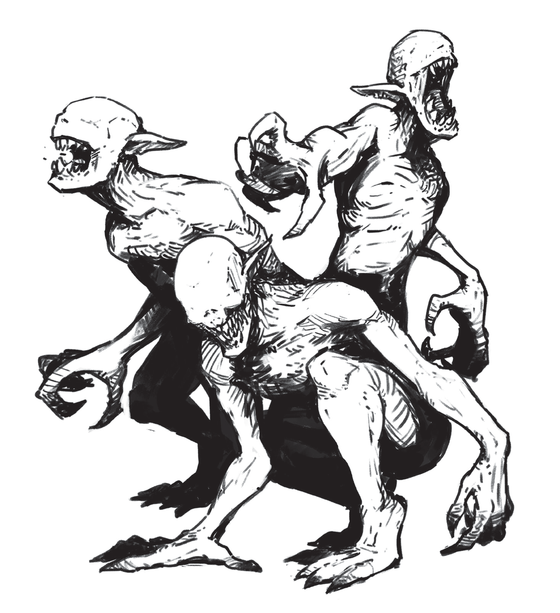
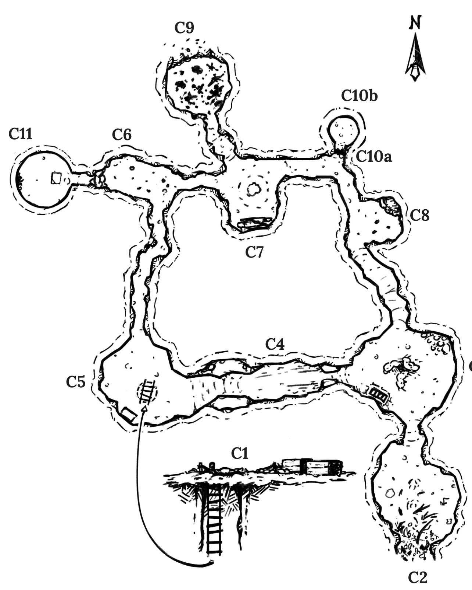
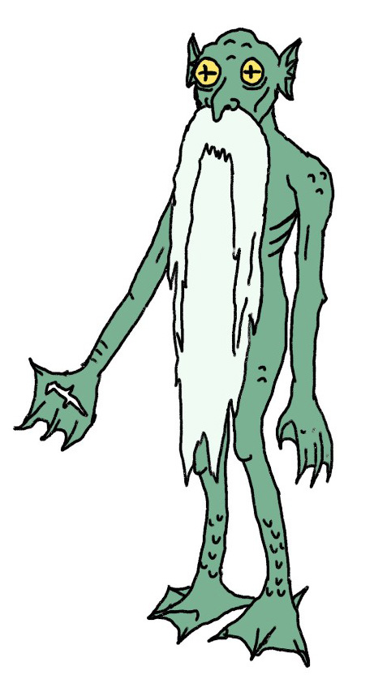

# CAS-2: Rise of the Blood Olms — 시나리오 정리

> 원본: `scenario/CAS-2_Rise_of_the_Blood_Olms.pdf` (12쪽, Yochai Gal · 2026-05, Text CC BY-SA 4.0)
> 전문: [src/scenario_blood_olms.md](src/scenario_blood_olms.md). 그림: [images/scenario/](images/scenario/)
> 입문용 · 치명적 · 신중한 탐험이면 생존 가능. PC 사망 시 개연성보다 빠른 합류 우선.

## 워든 원칙
- 방 묘사 때 곧 벌어질 일을 다시 말한다 (불붙은 통이 터질 것 같은가?).
- 위치 · 감각을 계속 재확인 (위험까지 거리, 물체 어느 쪽).
- 다음 통로 힌트 (고도 · 온도 · 빛 · 냄새 · 소리).
- 감정을 말하지 않는다. "사악한 칼" 말고 "길고 들쭉날쭉한 칼".

## 설정 (의뢰)
- 3주 전 **아홉의 결사(Order of Nine)** 가 **실버실크 강** 가 새 동굴 조사단(대표 **하이 렉터 게텔리**) 파견. 소식 끊김.
- 보상: 초승달 모양 유물 **진흙 체(Mud Sieve)** 회수 **1000gp** + 원 조사단원 1명당 **100gp**.
- 강 따라 와서 캠프 서쪽 도착. 시작 때 도착 시각 · 원하는 날씨 묻고 운명 주사위.

## 실제 사정
- 조사단이 **붉은 은자 나무(Red Hermit Tree)** 와 그 열매의 치유력 발견.
- 수확하려고 C9 에서 강을 **막음**(진흙 체 사용) → 나무에 물 끊김 → 열매 끊김.
- 박쥐는 C7 → C6 로 피신, **올름**은 굶주림. 일부가 튜브웜 고기 먹고 육식 광기 → **블러드 올름**.
- 게텔리도 튜브웜 고기 먹고 미침. 현지 동굴꾼 **헬-프리스** 는 C10b 에 숨음.

## 세력 · 배경
| 이름 | 설명 |
|---|---|
| 아홉의 결사 | 상인 · 학자 · 권력자 연합. 첩보망. 관문 발견 · 규제. 유물 · 뿌리 정보에 큰돈. |
| 조사단 | 게텔리(서기 학자, 거만, **생존·광기**) · 헬-프리스(현지 동굴꾼, 15세, **생존**) · 파라즈(서기 학자, 유물 전문, 결사원, **사망**) · 오렌(숲 안내, 경호, **사망**) |
| 뿌리(Roots) | 옛 세계 잔재. 도시 하수도~먼 폐허 연결 미로. 입구 = 관문. |
| 실버실크 강 | 도시 수원. "손가락" 협곡. 최근 수위 저하로 푸른 고리 동굴(C2) 드러남. |
| 붉은 은자 나무 | 반쯤 잠긴 동굴 천장에 거꾸로 자람. 물 + 메탄 필요. 열매: 신선하면 **STR 1 회복 + 결핍 해소 (하루 1회)**, 하루 지나면 갈색 · 썩은 냄새. 지금 물 부족으로 죽어감. |
| 올름 | 온순 · 눈멂 · 공기 호흡 · 오래 잠수. 청각 · 진동 · 온도 감지 탁월. 열매 · 수초 먹음. 말 못 하나 지능 높음. |
| 튜브웜 | 개만 한 초식, 짧은 다리, 눈멂, 머리에 뿔 같은 관. 성체 전부 사망. |

## 던전 개요 — 푸른 입 동굴 (Blue Mouth Caves)
- 입구: 캠프 C1(바위 턱 아래) · 동굴 입구 C2(캠프 아래쪽, C1 에서 안 보임).
- **빛 없음** (자연 · 인공 모두).
- **메탄**: C3 에 노출 분출구. 인화성. 오래 노출 → 두통 · 메스꺼움(결핍). 무취지만 **불꽃이 깜박이며 파래짐**.
- **던전 사건 '조우'** = C9 의 블러드 올름 셋 중 하나. 반응 굴림.

### 지도

### 방 (C1–C11)
| 방 | 이름 | 핵심 |
|---|---|---|
| C1 | 캠프 | 썩은 냄새(썩은 열매 상자). 상자: 녹슨 도구 1d6 + **곡괭이(d6)** / 열매 상자(하나만 멀쩡). 모닥불 1주 이상 식음. **굴 + 줄사다리 12ft → C5**. 담요 4장(작은 하나 = 헬-프리스). 동쪽 C2 로 발자국. |
| C2 | 동굴 입구 | 푸른 이끼(한 줌 10gp). C3 메탄 소리 희미. 옛 물속 흔적. 불이 파래지기 시작. |
| C3 | 튜브웜 둥지 | 숨막힘. 웜 시체 3(물린 자국). 알 d6(물에 두면 며칠 뒤 부화). 뜨거운 분출구. **불 들고 들어가면 폭발: 근처 전원 d6 STR, 광원 파괴.** 분출구 덮으면 1d4시간 뒤 숨쉴 만함. 가스는 C4 로 올라감. |
| C4 | 매복 방 | 좁은 복도, 높은 천장, 모래 바닥. 끌어다 놓은 바위 둘 사이 좁은 길. **첫 통과자: 게텔리가 위 턱에서 종유석 떨굼 (DEX 세이브 실패 d8 STR).** 북쪽 턱 2(오르기 쉬움, 맨 위에서 남쪽 턱 보임) · 남쪽 턱 1(천장 근처, 도구 · 시간 필요). 가장 낮은 턱에 사람 발자국. 불꽃 파래짐. |
| C5 | 사다리 방 | 천장 구멍 줄사다리(→C1). 철 상자: **쇠못 2 + 건조 식량(2회)**. 죽은 물고기, 진흙. 구아노 묻은 흰 발자국. |
| C6 | 박쥐 방 | 악취. 천장에 박쥐 수백(C7 에서 피신). 구아노 + 썩은 열매. 물갈퀴 발자국(추적 불가). 서쪽 벽 흰 곰팡이(먹으면 독) 뒤 **기어가는 굴 → C11**. |
| C7 | 아트리움 ([그림: 붉은 은자 나무](images/scenario/p007.png)) | 거꾸로 매달린 **붉은 은자 나무**, 죽어감. 작은 웅덩이(보급 한 번분). 시체 둘 = **파라즈 · 오렌** (블러드 올름에 찢김, 사흘 이상). 오렌: 단검(d6) · 횃불(1회) · 47gp. 파라즈: 나침반(55gp) · 무딘 삽(d6). **C9 댐 부수면 물 복구 → 나무 · C8 올름 생존, 박쥐 귀환.** |
| C8 | 올름 굴 | 따뜻 · 비좁음. **올름 10–14**, 병듦. PC 무시(신선한 열매 냄새 나면 반응). 벽화: 산에서 내려옴 → 열매 나무 발견 기쁨 → 한 올름이 튜브웜 먹고 쫓겨남. 북동쪽 샘(허리 높이 진흙 벽, 물 안전). **벽 부수면 C8 · C3 · C2 침수, 부분 회복. 단 C7 물 복구 없인 올름 결국 죽음.** |
| C9 | 블러드 올름 소굴 | 갓 깎은 진흙 벽. 시체 · 참상. **블러드 올름 최대 3.** 북쪽 **댐**(진흙 체로 만듦) — 손상 시 1d4분 뒤 터져 동굴 침수(DEX 세이브로 헤엄쳐 탈출). C1 로 들어왔거나 시끄러우면 깨어 경계(반응 굴림), C2 로 조심히 오면 잠듦. **댐 건드리면 공격.** |
| C10a | 봉쇄 | 바닥~천장 진흙 벽. 손으로 1시간, 도구로 몇 분. 흰 발자국이 벽 앞에서 끊김. 크게 말하면 C10b 가 응답(웅얼거림). |
| C10b | 피난처 | 둥근 매끈한 방. **헬-프리스**: 삽 겨눔, 다른 손에 **진흙 체(충전 1 남음)**. 사정: 괴물이 횃불 끄고 습격 → 게텔리와 C8 올름 속에 숨음 → 게텔리가 덤빔 → 진흙 체 들고 C10a 벽 뒤로. 게텔리가 튜브웜 먹은 것 인정. **안전하다 느껴야 진흙 체 넘김.** |
| C11 | 우물 | 마른 우물 바닥, 위로 80ft 뒤 무너진 진흙 천장. 잡동사니: 옛 양동이 · 도자기 잔 세트(**150gp**, 깨지기 쉬움) · 사람 해골(루살 것, 만지면 저주). 돌판 위 캔버스 = 루살 잠자리. **박쥐가 C6 떠나지 않았으면 루살 있음.** |

## NPC
### 루살 (Rusal) — 물의 정령

- 초록 피부 노인, 발끝까지 흰 수염, 개구리 눈, 물갈퀴, 늘 알몸.
- 늘 이 동굴에 살았음. 박쥐에 집(C6) 뺏겨 우물로. 자연 불균형 걱정하나 블러드 올름엔 손 안 댐 — "이제 새 균형의 일부지."
- **박쥐가 C7 로 돌아가면** 크게 고마워하며 PC 1명에게 **은혜(boon) d6**.
- 아니면 거래: 큰 힘을 주되 값은 **추상 개념** (말 · 고향 기억 · 야망 · 웃음…). 거래 속 거래를 사랑.
- 일반 수단으로 해칠 수 없음. 담배 · 향 연기 싫어해 도망. 음악 · 춤 좋아함.

| d6 | 은혜 (중복 · 부적합 시 재굴림) |
|---|---|
| 1 | 수중 호흡. 물속에 오래 있을수록 돌아가야만 함. |
| 2 | 병 · 질환 치료. STR 또는 DEX 재굴려 그 값. |
| 3 | 위대한 재능. 단, 아무 기쁨도 없음. |
| 4 | 무작위 주문서를 머리에 새김 (WIL 1d4 잃음, 주문서 파괴). |
| 5 | 어떤 문이든 한 번 여는 열쇠. 물고기 뼈 모양 (petty). |
| 6 | 강력한 비밀 하나의 진실. 본인만 들음. |

### 능력치
| 이름 | HP | STR | DEX | WIL | 공격 | 특징 |
|---|---|---|---|---|---|---|
| 블러드 올름 | 8 | 14 | 11 | 4 | 발톱 d8+d8 | 눈멂, 열 감지 사냥, 동족 포식. 메탄 피함, **불꽃 끄려 함**. **붉은 은자 열매에 쫓김**. 치명 피해 시 살점 물어뜯음 d6 STR. |
| 올름 | 2 | 8 | 6 | 12 | 발톱 d8+d8 | 채식. 자기 방어만. |
| 헬-프리스 | 2 | 8 | 14 | 11 | 삽 d6 | 15세 현지 동굴 잠수꾼. 진흙 체 소지. |
| 하이 렉터 게텔리 | 6 | 11 | 15 | 17 | 갈아 세운 쇠못 d6 | 미친 서기 학자, 눈 진홍. 진흙 체 사용법 두루마리(petty, 검은 표시 3 = 재충전 시 충전 수). 도시 전문 치료로만 회복. 동굴 떠나기 거부, 산 것 보면 죽이려 함. |

## 유물 — 진흙 체 (Mud Sieve)
- 손바닥만 한 초승달 돌. **진흙을 물처럼 빚고 가름.** 충전 3 (현재 1).
- 재충전: 거센 강물에 하룻밤 하루 두었다가 회수.

## 해결 갈래 (정리용 메모)
- **목표**: 진흙 체 회수(1000gp) + 생존자 헬-프리스 · 게텔리 구출(각 100gp).
- **복구**: C9 댐 파괴 → C7 나무 · C8 올름 · 박쥐 귀환 → 루살 은혜. 블러드 올름이 막음.
- **부분 복구**: C8 샘 벽 파괴 → 침수, 그러나 올름은 결국 죽음.
- **위협**: C3 메탄 폭발 · C4 종유석 매복 · 블러드 올름(불 끄고 습격) · 게텔리.
- **도구**: 붉은 은자 열매(블러드 올름 퇴치, C1 에 하나 멀쩡) · 진흙 체 · 곡괭이 · 쇠못 · 담배/향(루살).
